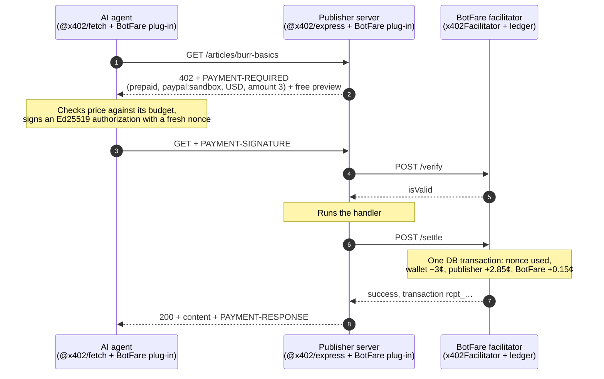
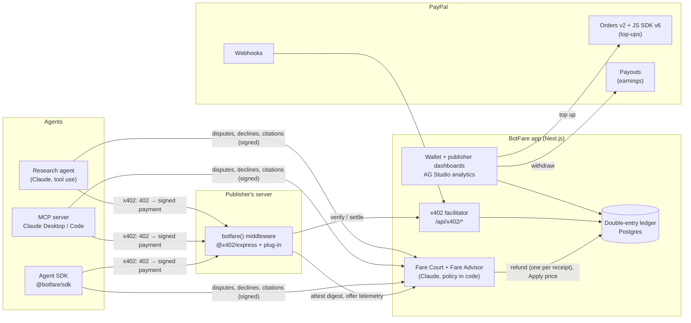

# BotFare

**Every bot pays its fare.**

BotFare is pay-per-request for AI agents, settled on PayPal: **x402 for PayPal's 440 million accounts.**

AI agents read pages and call APIs for free, and the open standard for paying per request, [x402](https://github.com/x402-foundation/x402), settles in stablecoins on blockchains. PayPal is a Premier member of the x402 Foundation, yet x402 has no way to settle to a PayPal account. BotFare adds one: a new x402 payment type, scheme `prepaid` on network `paypal:sandbox`, that plugs into the official x402 SDK.

- **Publishers and API owners** add one line of middleware, set a price per page or call, and get paid through **PayPal Payouts**.
- **Agent owners** top up a balance with **PayPal Checkout** and give each agent a key with a budget: daily cap, per-request max, allowed sites.
- **Agents** pay a few cents per request with a signed x402 payment. Humans browsing the same site are never charged: BotFare decides who pays with a score, never a hard block ([who pays](#who-pays-agent-detection)).
- **AI on every side of the fare**: Claude makes the decisions too small for a person (is this page worth 3¢? was it what was promised? what should it cost?), and code moves the money ([Fare Court and Fare Advisor](#ai-on-every-side-of-the-fare)).

Built for the [PayPal AI Hackathon](https://paypalaihackathon.devpost.com/), November 2026.

**Judges:** open `/judge` on the running app for a two-minute guided tour (publisher, wallet, research agent, and a 402 you can curl), or run the whole stack locally with one Docker command ([below](#run-everything-in-docker)).

## Why it needs a ledger

A PayPal payment costs at least 49¢ in fees (3.49% + $0.49), and even PayPal's micropayments rate is 4.99% + 9¢. Neither works for a 3¢ article. BotFare batches the PayPal side and settles each request in its own ledger:

| | PayPal per read | Through BotFare |
| --- | --- | --- |
| Agent owner | ~49¢ fee on every 3¢ read | One $5.00 top-up, one **$0.66** fee (measured in sandbox), about 166 reads |
| Publisher | One payment per read | One Payouts batch for all of a day's earnings |
| Each request | A full PayPal transaction | A signed authorization, a ledger posting and a receipt |

## How a paid request works



Settlement happens only after the publisher's handler succeeds, so an agent is never charged for a failed response. Each authorization is single-use and expires within 60 seconds.

## Who pays: agent detection

`botfare()` decides who gets a 402 with a score, never a block: **pay, or prove you're human.** A request that is not charged is served free, and a 402 is an offer, not a refusal. Each publisher picks a level in the dashboard's **Bot detection** tab:

| Level | Who pays |
| --- | --- |
| Off | Only agents that identify themselves: signed agents, the `x-botfare-agent` header, an x402 payment |
| Known AI bots (default for new sites) | Also known AI crawlers, and anything that claims to be one from outside its published IP ranges |
| Standard (Crema Notes) | Also requests whose automation score reaches 60 (CDN bot scores, HTTP-client and headless signs) |
| Strict | Like Standard, from a score of 40 |

The first signal that charges at the site's level is recorded on the receipt and sent to BotFare in the x402 requirements (`extra.botfareSignal`), so the analytics show **revenue by detection signal**:

| Signal | Seen when | Charges at |
| --- | --- | --- |
| `signed-agent` | A valid Web Bot Auth signature (RFC 9421, Ed25519) from a BotFare agent key. The SDK signs every request; BotFare publishes the keys at `/.well-known/http-message-signatures-directory` | every level |
| `agent-header` | The request sends `x-botfare-agent` | every level |
| `known-bot` | An AI crawler user agent (GPTBot, ClaudeBot, PerplexityBot, CCBot, …) from its published IP ranges, a crawler that publishes no ranges, or a CDN-verified bot | Known AI bots and up |
| `bot-impostor` | A crawler user agent from outside that crawler's published ranges (score 90) | Known AI bots and up |
| `edge-score` | Cloudflare `cf-bot-score` at or below 29, or an Akamai bot verdict, when the publisher enables those headers | Standard, Strict |
| `automation` | HTTP client user agents (curl, python-requests, Node fetch: 80), headless browsers (80), no user agent (70), any other user agent that is not a browser, i.e. has no `Mozilla/` token, such as `research-bot/1.0` (70), a desktop-browser user agent without a real `Accept-Language` (30) or without `Sec-Fetch-Site`/`-Dest` (30) | Standard, Strict |
| `payment-signature` | An x402 payment and nothing above | every level |
| `everyone` | The path charges every request (the brew API) | every level |

**The human check.** A browser asking for HTML that is charged only on a score (`automation` or `edge-score`) gets a page that says "Reading as a human? Continue free." with a Cloudflare Turnstile widget, still as a 402 that carries the offer for agents. Passing it posts to `/__botfare/human`, which verifies the token with Cloudflare and sets a signed, HttpOnly, 24-hour `botfare_human` cookie; the reader returns to the page and reads free. The pass switches off scores only: it never covers a self-identified agent, a signed agent, a crawler or an impostor. Crema Notes uses Cloudflare's always-pass test key, so the demo works without a Cloudflare account; a test site key always uses Cloudflare's test secret, and a real site key needs its own widget's secret in the publisher's `TURNSTILE_SECRET_KEY` (botfare() logs it when that is missing or is a test secret). If BotFare's facilitator is briefly unreachable, the check is still served (as a 503 page), so a suspected human is never stuck. A real Chrome, Firefox or Safari scores at most 30 (plain HTTP to a LAN address) and is never charged at any level, even without the check.

**Honest limits.**

- The heuristics read request headers only. A scraper that copies a real browser's full header set reads free, by design: wrongly charging a person costs more than a missed bot. Signed agents, the agent header, crawler checks and CDN scores are what catch it.
- Link-preview fetchers of chat and social apps (Slack, Discord, Telegram, WhatsApp, iMessage, LinkedIn, Teams, Mastodon) are never scored on their user agent: they fetch a link once for the person who just shared it, and charging them would break link sharing for the publisher's own readers. A scraper can claim to be one of them. Search crawlers without a `Mozilla/` token (Googlebot-Image, for one) score 70 like any other non-browser; most search crawlers send the token and are unaffected.
- No IP reputation, datacenter lists or request-rate signals.
- The crawler ranges are a snapshot (677 prefixes from OpenAI, Anthropic, Perplexity, Google, Apple and Common Crawl, fetched 8 Nov 2026) and need refreshing. Bytespider, Amazonbot and meta-externalagent publish no usable list, so they are matched by user agent alone.
- The crawler check uses `req.ip`: behind a proxy or CDN the publisher must set Express's `trust proxy`, or real crawlers look like impostors (still charged only from Known AI bots up).
- CDN headers are trusted as sent: turn them on only when the CDN sets them and strips client copies. With Cloudflare enabled, every CF-verified bot (search crawlers included) counts as `known-bot`.
- The human pass is not bound to an IP or browser: a scraper that solves Turnstile once gets 24 hours past the scores, though never past the other signals.
- Sites created before detection keep their old behaviour (off, or Known AI bots if they charged known bots); BotFare's key directory is not itself signed.

## The research agent

`/agent` (signed in as the agent owner) runs a Claude agent with a BotFare key and a budget of 5¢ to $1.00. It has six tools, and every input is validated with zod; the model never sees the agent key, the wallet or PayPal:

| Tool | What it does | Moves money? |
| --- | --- | --- |
| `list_sources` | The BotFare sites and their free `catalog.json`: titles, prices, excerpts | No |
| `get_offer` | One unpaid request: the 402's price and the free preview | No |
| `buy` | Pays through the SDK (x402 `prepaid`), returns the page text and the receipt ID, with a reason the owner sees | Yes |
| `skip` | Records a decision not to buy, with the reason and a category; the publisher gets it as a free decline note for its [Fare Advisor](#fare-advisor-why-didnt-the-bot-buy) | No |
| `dispute` | Takes a page bought in this run that is not what its offer declared (a stub, an error page) to [Fare Court](#fare-court-buyer-protection-for-3-purchases) with the exact bytes received; at most 2 per run, and a disputed page cannot be cited unless the dispute was denied | Only back to the run (a refund) |
| `finish` | The answer; every citation must name a receipt bought in this run, and the citations are reported to BotFare | No |

Hard limits live in code, not in the prompt: 10¢ per page (the 50¢ trap article is refused by the SDK before anything is signed), the run's budget (the SDK's per-request cap is always the smaller of 10¢ and what is left, whatever price the free offer showed; a page served after a signed payment but without a receipt still counts), and the key's daily cap, enforced again by the facilitator. The page streams the run over SSE: a timeline of offers, decisions, payments and refusals, a cost meter, a **wire inspector** (decoded `PAYMENT-REQUIRED`, the signed JWS header and claims, `PAYMENT-RESPONSE`) and the cited answer, each citation linked to its receipt.

It needs `ANTHROPIC_API_KEY` (model `ANTHROPIC_MODEL`, default `claude-sonnet-5-5`) and `BOTFARE_AGENT_KEY` (written by `pnpm seed`); without them the page says what is missing. The tests drive it with a scripted model.

What it may read: the demo publisher (the site registered at `DEMO_ORIGIN` / `DEMO_PUBLIC_URL`, or `http://localhost:4000` in local development) and, for a user signed in with their own account, that user's own sites. Sites other people register, including through the shared publisher persona, never reach anyone else's run. Every request goes through an outbound guard: redirects are not followed, and in production a host that is, or resolves to, a loopback, private, link-local, CGNAT or IPv4-mapped IPv6 address is refused (the configured demo origin excepted). Page text is extracted in one linear pass, so a hostile page cannot stall the server. Known limit: the address check is a lookup just before each request, so DNS rebinding inside that moment is not caught.

## AI on every side of the fare

Micropayments have failed for 25 years less on technology than on the **decision cost**: every tiny payment asks for a decision that costs more attention than the payment is worth (Nick Szabo, ["Micropayments and Mental Transaction Costs"](https://nakamotoinstitute.org/micropayments-and-mental-transaction-costs/), 1999; Clay Shirky, "The Case Against Micropayments", 2000). x402 removes the technical cost and BotFare's batching removes PayPal's fee; the decision cost is still there at every seat. **BotFare puts AI on the decisions that are too small for a person, and keeps money movement in code.**

| Seat | The micro-decision | AI in BotFare |
| --- | --- | --- |
| Agent (buyer) | Is this page worth 3¢? | Research agent and MCP server: Claude reads the free offer, buys or skips with a reason |
| Publisher | What should this page cost an AI? | **Fare Advisor**: prices from what agents say and do |
| BotFare (referee) | Was that 3¢ page what was promised? | **Fare Court**: AI arbitration of micro-disputes |
| Agent owner | How much may my agent spend, and where? | Caps today (daily cap, per-request max, allowed sites); a plain-English allowance is on the backlog |

Every model answer is checked with zod before anything happens, and nothing the model says moves money by itself: refunds happen only through code with fixed thresholds (or a publisher's click), and prices change only when the publisher clicks **Apply**.

### Fare Court: buyer protection for 3¢ purchases

PayPal's Buyer Protection, for purchases too small for a person to dispute.

1. **The offer is declared.** `botfare()` puts the page's title, preview and word count in the payment requirements (`extra.botfareOffer`); BotFare stores that declaration on the receipt at settle.
2. **Delivery is proven.** After a paid response is sent, `botfare()` attests a SHA-256 digest (RFC 9530 `Content-Digest`) of the exact bytes it delivered for that receipt. The agent cannot fake what it got, and the publisher cannot deny what it sent.
3. **The agent disputes.** Within 24 hours, the agent sends the receipt, a reason and the bytes it received, signed with its key (`agent.dispute()` in the SDK, `dispute_purchase` in the MCP server, the research agent's `dispute` tool). BotFare checks that the bytes hash to the attested digest; a mismatch or a late dispute is stored as `invalid`.
4. **Claude compares** the declared offer with the delivered text, treating both as untrusted data, and returns a structured verdict (decision, confidence, category, rationale, evidence), validated with zod.
5. **Policy decides, in code** (`DISPUTE_POLICY`): a `refund` verdict at 80% or more refunds at once through the ledger's one-refund-per-receipt path; a `deny` at 80% or more closes the dispute; everything else goes to the publisher's **Disputes** page (`/publisher/disputes`) with the AI's reasoning, the declared offer next to the delivered excerpt, and Accept refund / Decline refund. Each key may file 10 disputes a day, and once a key disputes more than a fifth of its purchases in 7 days, its refunds need the publisher.

The demo case: Crema Notes' 3¢ "Grinder maintenance, step by step" has a real preview, and people read it in full, but an agent that pays gets a "Subscribe to keep reading" stub. The research agent disputes it, and with an Anthropic key the 3¢ comes back in seconds; without one the dispute waits for the publisher, who sees the stub next to the promise. The shared demo research key that every judge's run uses gets 200 disputes a day and no dispute-rate rule (other keys keep the policy), so one judge's runs cannot switch instant refunds off for the next.

### Fare Advisor: "Why didn't the bot buy?"

The publisher dashboard's **Fare Advisor** card shows a funnel per pricing rule and per page over the last 14 days, at each rule's current price (after a price change the rule starts afresh and says so; the old price's signals stay in the site totals, and the AI is not asked about a rule until agents have seen its new price):

- **offers shown**: 402s the middleware reports in batches (path, method, price, detection signal; no personal data);
- **paid**: receipts;
- **declined**: free, optional notes from agents (`agent.decline()`, MCP `decline_offer`, the research agent's skip reasons) with a category and one sentence, for a price the site really charges for that page; at most one per key, page and day (query strings do not count) and three per agent owner, page and day, however many keys the owner makes;
- **cited**: which paid reads an agent's answer actually used. **Citations are the new clicks**: they replace the clicks AI summaries took away, and the analytics dashboard shows "Cited vs paid by page";
- **disputed**: Fare Court cases.

Claude groups the decline reasons per page and recommends price, preview or audience changes. Every recommendation is checked in code before it is shown: the pattern must be one of the site's rules, its evidence must match the real counts and reasons, and its text may not contain numbers that are not in the data. The projected weekly revenue comes from BotFare's own funnel model, not from the model. **Apply** opens a confirmation, then changes the pricing rule; the middleware picks it up within 30 seconds. The demo story (`pnpm seed:traffic`, refreshed weekly on Render so it never leaves the 14-day window): the 50¢ premium roundup is shown dozens of times, bought rarely and declined as "Thin listicle, not worth 50¢" and "Preview lists names only", while burr-basics and dialing-in are cited in most answers that paid for them.

### Honest limits

- The judge reads text, not the page: at most 12,000 characters of the delivered body with HTML reduced to text in one linear pass over at most 200,000 characters (the publisher's review shows a 4,000-character excerpt). Images, layout and anything past that are not compared. Of the publisher's attested `Content-Type` only the media type (`text/html`) is kept, and it reaches the judge inside a data block.
- Publishers decide uncertain cases. An unsure or invalid verdict, an empty or error page (a pre-check, so no model call), a model error or timeout, the judge's own token budget, or a missing `ANTHROPIC_API_KEY` all send the dispute to the publisher; none of them refunds.
- Proof of delivery depends on the publisher's middleware. A receipt the publisher never attested cannot be disputed (`not_attested`; the SDK re-files twice in case the attestation is a moment late), and a publisher that attests a digest of something it did not send makes the agent's honest bytes fail as a mismatch. The digest covers the bytes `botfare()` sees, so `compression()` must be mounted before it.
- Earnings already paid out cannot be refunded automatically: the dispute waits for the publisher until new earnings cover it.
- Telemetry is best effort: the middleware sends batches every 15 seconds (or 200 events), keeps at most 2,000 waiting, and drops a batch BotFare does not accept, so offer counts are a floor. BotFare drops a malformed event (a control character in its path) on its own, and stores at most 20,000 events per publisher per day. Rate limits, the Advisor's cache and the AI budgets live in memory on one web instance.
- Decline notes are the agents' word. BotFare keeps only notes for a price the page really has, one per key, page and day and three per agent owner, page and day, but it does not check that the agent was shown the 402; a determined account owner can still add a few notes a day to a page.
- A paid redirect is not followed by the SDK or the research agent: the 3xx is what was settled and attested, so it comes back as paid with its receipt, and can be disputed.
- Receipts do not record the HTTP method, so purchases, declines and citations count under the first rule that matches their path.
- The revenue projection is a simple, labelled estimate (fixed elasticities, half of preview-related declines won back). The structured-output requests have been tested with scripted models; the live API path still needs one run with a key.

## MCP server

[`packages/mcp`](packages/mcp/README.md) lets Claude Desktop and Claude Code pay BotFare sites from a local process: `get_offer`, `fetch_paid` (capped by the key's limits and an optional `max_price_usd`), `decline_offer` (skip with a reason for the publisher), `dispute_purchase` (Fare Court, with the exact bytes it received), `wallet_balance` and `recent_receipts`. The agent key stays in that process; the wallet, receipts, decline and dispute calls authenticate with the request's own Web Bot Auth signature, with no API token ([protocol](docs/PROTOCOL.md#agent-api-signed-requests-no-tokens)). Setup for both clients is in its [README](packages/mcp/README.md).

## Judge mode and Log in with PayPal

`/judge` is a one-page tour: sign in as the publisher, the agent owner, or go straight to the research agent, plus copy-paste curl commands that show a person reading free and an agent getting a 402. The demo personas need no password and are shared, so signing in restores Crema Notes' prices and payout email, and the site secret, payout account and seeded agent keys are locked. Every judge's research run pays with the one seeded demo key (10¢ per page, $10.00 a day), and the agent owner's wallet is put back to $5.00 at sign-in and before each run, so earlier judges cannot leave it empty. Runs are one at a time per visitor (user and IP), not per shared persona. When `JUDGE_SANDBOX_BUYER_EMAIL` and `JUDGE_SANDBOX_BUYER_PASSWORD` are set, the page shows that PayPal **sandbox** buyer (fake money) for approving a top-up.

Publishers who want their own account use **Log in with PayPal** (sandbox), which signs them in by their verified PayPal email and sets it as their payout email. It is off until `PAYPAL_LOGIN_ENABLED=true`, because the sandbox app must be set up first:

1. developer.paypal.com > Apps & Credentials > Sandbox > the BotFare app > **Features**: tick **Log in with PayPal**, then **Advanced settings**.
2. Return URL: the app's `BOTFARE_URL` followed by `/api/auth/paypal/callback`, exactly:
   - Render: `https://<botfare-web>.onrender.com/api/auth/paypal/callback`
   - local: `http://localhost:3000/api/auth/paypal/callback`
   - judge Docker stack: `http://localhost:3300/api/auth/paypal/callback`
3. Information requested: **Email** (and Full name). Add the privacy policy and user agreement URLs PayPal asks for, then save.
4. Set `PAYPAL_LOGIN_ENABLED=true` and restart the app; `/signin` shows the button.

The callback checks a one-time `state` cookie, exchanges the code with the app's own credentials, requires `email_verified`, and refuses the shared demo emails.

## Architecture



## The x402 plug-in

[`packages/x402-paypal`](packages/x402-paypal) implements all three sides of the x402 V2 SDK's plug-in interfaces for the `prepaid` scheme on `paypal:*` networks:

| Side | Class | What it does |
| --- | --- | --- |
| Agent | `PrepaidPayPalClient` (`SchemeNetworkClient`) | Signs an Ed25519 JWS over scheme, network, asset, amount, payee and a fresh nonce |
| Publisher | `PrepaidPayPalServer` (`SchemeNetworkServer`) | Turns `"$0.03"` into `{ asset: "USD", amount: "3" }`; uses the verify, serve, settle flow |
| Facilitator | `PrepaidPayPalFacilitator` (`SchemeNetworkFacilitator`) | Checks the signature, expiry and field binding, then charges through a ledger port |

A decoded `PAYMENT-REQUIRED` header from the official `@x402/express` middleware looks like this:

```json
{
  "x402Version": 2,
  "resource": { "url": "https://demo.example/articles/burr-basics", "description": "Burr grinders, explained", "mimeType": "text/html" },
  "accepts": [
    { "scheme": "prepaid", "network": "paypal:sandbox", "amount": "3", "asset": "USD", "payTo": "site_demo", "maxTimeoutSeconds": 60, "extra": {} }
  ]
}
```

It follows the precedent of Cloudflare's `batch-settlement` scheme (`cloudflare:402`, USD in cents, Ed25519-signed agents) in the x402 repo.

## PayPal APIs used

| Need | PayPal API | Where |
| --- | --- | --- |
| Top up an agent wallet | Orders v2 (`payment_source.paypal.experience_context`), JS SDK v6 | [`packages/paypal`](packages/paypal), wallet page |
| Book PayPal's fee in the ledger | Capture `seller_receivable_breakdown.paypal_fee` | [`packages/paypal`](packages/paypal) |
| Pay publishers | Payouts (`sender_batch_id` idempotency, batch and item status) | [`packages/paypal`](packages/paypal) |
| Keep money state in sync | Webhooks + `verify-webhook-signature` | [`packages/paypal`](packages/paypal) |
| Refund unused balance | Capture refunds | [`packages/paypal`](packages/paypal) |
| Verified publisher identity | Log in with PayPal | publisher sign-in |

Everything runs in the PayPal **sandbox only**.

## Status

| Piece | State |
| --- | --- |
| x402 plug-in (`prepaid` on `paypal:sandbox`) | ✅ Works end to end with the official `@x402/express`, `@x402/fetch` and `x402Facilitator` 2.30.0 ([spec](docs/PROTOCOL.md)) |
| PayPal client: orders, capture, refunds, Payouts, webhooks | ✅ Built and tested |
| Sandbox spikes: OAuth, $5 top-up, $0.25 Payout, JWS, x402 | ✅ All pass ([results](docs/SPIKE_RESULTS.md)) |
| Postgres double-entry ledger, `PostgresPrepaidLedger`, refunds | ✅ Built; DB tests cover concurrency, caps, replays and refunds |
| Facilitator API in the Next.js app (`/api/x402/*`, site config, health) | ✅ Built; site Basic auth |
| `botfare()` publisher middleware, agent SDK (`getOffer`, paid `fetch`, spend cap, wire events) | ✅ Built |
| Crema Notes demo publisher (articles + brew-ratio API) | ✅ Built |
| `pnpm seed` + `pnpm e2e`: Phase 1 on real processes and Postgres | ✅ All checks pass |
| Render Blueprint ([`render.yaml`](render.yaml)): app, demo, daily payouts cron, Postgres | ✅ Written, not yet deployed |
| Wallet: balance, PayPal JS SDK v6 top-up, agent keys made in the browser, receipts | ✅ Built; sandbox order creation checked live, approval needs a sandbox buyer login |
| Publisher dashboard: sites, pricing editor, one-time secrets, earnings, Withdraw now, payout history | ✅ Built; a real sandbox Payout ($11.72) reached `SUCCESS` |
| PayPal webhooks (`/api/paypal/webhook`, verified, deduped) and `pnpm payouts:run` | ✅ Built and tested against a mock PayPal |
| Publisher analytics in AG Studio, with a Claude assistant | ✅ Built |
| `pnpm seed:traffic`: ~150 paid requests over 14 days for the dashboards, plus the Fare Court and Fare Advisor story | ✅ Built |
| Agent detection: signed agents (Web Bot Auth), crawler IP checks, CDN scores, heuristics, Turnstile human check, Bot detection panel, revenue by signal | ✅ Built; `pnpm e2e` checks it on real servers |
| Research agent (`/agent`): tools, budget and caps, SSE timeline, wire inspector, cited answer | ✅ Built; tested with a scripted model (a live run needs `ANTHROPIC_API_KEY`) |
| MCP server ([`packages/mcp`](packages/mcp/README.md)) and the signed agent API | ✅ Built and tested against an in-process publisher and facilitator |
| `/judge` tour and judge mode | ✅ Built |
| Fare Court: declared offers, attested `Content-Digest`, signed disputes, Claude judge with policy in code, publisher Disputes page, SDK/MCP/research agent disputes, the Crema Notes stub case | ✅ Built; `pnpm e2e` checks it on real servers without an AI key (the publisher decides); a live verdict needs `ANTHROPIC_API_KEY` |
| Fare Advisor: offer telemetry, decline notes, citations, funnel per rule, checked Claude recommendations, Apply, citations in analytics | ✅ Built; `pnpm e2e` checks the funnel and Apply → middleware → next agent buys; live recommendations need `ANTHROPIC_API_KEY` |
| Log in with PayPal | ✅ Code done and tested against a mock PayPal; off until the sandbox app has it enabled |
| One-command Docker stack ([`docker-compose.full.yml`](docker-compose.full.yml)) | ✅ Built and checked |
| Deploy to Render | ⏳ Next |

The full proposal, decisions and day-by-day plan are in [`docs/PLAN.md`](docs/PLAN.md).

## Repository layout

```text
packages/x402-paypal   the x402 plug-in: client, server and facilitator parts, JWS helpers, ledger port, in-memory ledger
packages/contracts     types and helpers shared across every HTTP boundary: IDs, site config, pricing rules, agent keys,
                       detection config and signals, Web Bot Auth signing and verification (./web-bot-auth)
packages/core          Drizzle schema and migrations, Postgres double-entry ledger, PostgresPrepaidLedger, services
packages/express       botfare({ siteId, siteSecret }): one-line publisher middleware on @x402/express, with the
                       agent detection engine (src/detection), the Turnstile human check, the declared offer,
                       proof of delivery (Content-Digest attestation) and offer telemetry
packages/sdk           createBotFareAgent(): getOffer(), a paying fetch on @x402/fetch, dispute(), decline() and
                       reportCitations(); signs every request
packages/paypal        typed PayPal REST client (sandbox only)
packages/mcp           MCP server for Claude Desktop and Claude Code: get_offer, fetch_paid, decline_offer,
                       dispute_purchase, wallet_balance, recent_receipts
apps/web               Next.js: landing page, /judge, sign-in (personas, Log in with PayPal), wallet,
                       research agent (/agent), publisher dashboard, Disputes and analytics, Fare Court
                       judge and Fare Advisor, x402 facilitator API (/api/x402/*), agent API (/api/agent/*,
                       /api/disputes, /api/offers/decline, /api/citations), PayPal webhook, site config, health
apps/demo              Crema Notes: fictional coffee site and brew-ratio API behind botfare()
scripts/seed.ts        demo personas, site, $5 wallet and agent key, written to .env
scripts/traffic.ts     demo traffic: three more agent keys, ~150 paid requests over 14 days, and the Fare Court
                       and Fare Advisor story (offers, declines, citations, disputed stub purchases)
scripts/payouts.ts     daily PayPal Payouts batch and status sync (a Render cron runs it)
scripts/e2e.ts         end to end: web app + demo + Postgres, payments, detection, Fare Court and Fare Advisor,
                       PASS/FAIL per check
scripts/spike          Day-0 PayPal and x402 spikes
docs                   plan, protocol spec, spike results
render.yaml            Render Blueprint: botfare-web, botfare-demo, botfare-payouts (cron), Postgres 17
docker-compose.full.yml the whole stack for judges (project botfare-judge); docker/ has its scripts and README
```

## Run it locally

You need Node 22+ (the repo pins 24 LTS in `.node-version`; Render uses it too, and Node 25+ no longer bundles the Corepack the Render build enables), pnpm 10 and Docker.

```bash
pnpm install
cp .env.example .env    # PayPal sandbox keys: top-ups, Withdraw now and the spikes need them
pnpm db:up              # Postgres 17 in Docker (botfare and botfare_test databases)
pnpm db:migrate         # apply the Drizzle migrations to DATABASE_URL
pnpm seed               # judge personas, Crema Notes site, $5.00 wallet, agent key -> .env
pnpm seed:traffic       # ~150 paid requests over the last 14 days, plus the Fare Court and Advisor story
pnpm e2e                # start the app and the demo, pay for content, check every ledger movement
```

`pnpm e2e` starts the BotFare app (`next dev` on :3000, reused if it is already running) and the demo (:4000). To run it beside your own dev servers, use other ports and the production build (Next allows one `next dev` per app):

```bash
pnpm --filter @botfare/web build
WEB_PORT=3100 DEMO_PORT=4100 E2E_WEB=start pnpm e2e
```

It then checks:

- a human in a real browser (full Chrome headers) reads an article free;
- `getOffer` shows 3¢ with a preview and moves no money;
- the agent pays and gets a receipt;
- the ledger moved exactly (wallet −30,000 micro-dollars, publisher +28,500, BotFare +1,500);
- a replayed payment is refused with `nonce_used` and the original receipt;
- a 50¢ article is refused by the 10¢ cap before anything is signed;
- the brew API charges 1¢ to any paying client;
- a refund restores the wallet exactly once;
- curl and python-requests without the agent header, a script with a bare Chrome user agent, and a `research-bot/1.0` user agent get a 402 with signal `automation`, while a Slack link preview reads free;
- a GPTBot user agent from 127.0.0.1 is a `bot-impostor`;
- the SDK's signed requests are recognised as `signed-agent` and pay;
- a headless browser gets the Turnstile page, Cloudflare's test token sets the human pass, and its next read is free (an agent with the same cookie still pays);
- each receipt records the right detection signal;
- Fare Court: the paid stub article declares its offer and the demo attests the digest of exactly the bytes the agent received; a dispute with tampered bytes is `invalid`; a dispute with the real bytes is accepted and, with no AI judge, waits for the publisher; the publisher's accept through the API refunds 3¢ exactly once, and a second accept or dispute is refused;
- Fare Advisor: a decline note and a citation report are recorded, the middleware's offer telemetry reaches BotFare, the advisor returns the funnel per rule with `aiAvailable: false`, and Apply 50¢ → 8¢ on the premium rule shows in the site config, reaches the middleware within 30 seconds, and the 10¢-capped agent then buys it (the price is put back to 50¢ afterwards);
- the ledger sums to zero.

The web app it starts runs without `ANTHROPIC_API_KEY`, so the required checks cover Fare Court's no-AI path. With a key in `.env`, `E2E_AI=1` keeps it and adds an optional check that the AI judge refunds the stub at once.

The human-check step calls Cloudflare's real siteverify with the public test secret, so it needs network access.

It exits non-zero on any failure.

To click around yourself:

```bash
pnpm dev:web            # BotFare app on http://localhost:3000 (GET /api/health)
pnpm dev:demo           # Crema Notes on http://localhost:4000, payments on with the seeded site
```

Open http://localhost:3000/signin and pick a persona:

- **Agent owner** (`/wallet`, `/agent`): balance, a PayPal top-up button ($5, $10 or $20, approved with a sandbox buyer account), agent keys generated in the browser with their budgets (revoked keys are hidden until "Show revoked"), receipts, and the research agent.
- **Publisher** (`/publisher`, `/publisher/disputes`, `/publisher/analytics`): earnings, Withdraw now to `PUBLISHER_PAYPAL_EMAIL` through PayPal Payouts, payout history with "Refresh status", the Fare Advisor card, the pricing editor, Fare Court's Disputes page, and the AG Studio analytics dashboard.

`pnpm seed:traffic` is safe to run again: nonces, the wallet funding and two publisher refunds are keyed by its run key, and the plan's dates are anchored to the first run (stored with the funding), so a rerun moves no money on the same day or any later one. `pnpm seed:traffic --run-key <name>` adds a fresh batch, and `--weekly` names it after the ISO week (what the Render cron runs). The story is dated inside the 14 days before its run, so it leaves the Fare Advisor's window two weeks later; offers and citations are written only for that run's own purchases, so overlapping batches never count one twice. It settles every request through `PostgresPrepaidLedger` with a clock set to the request's time, so per-request maxes, daily caps and allowed sites apply as they would live. It then writes the Fare Court and Fare Advisor story through the same core services the live endpoints use: offers shown for every article, the premium roundup declined again and again at 50¢, burr-basics and dialing-in cited often, and four stub purchases of the grinder-maintenance article, attested and disputed (three refunded by policy, one waiting for the publisher). Those verdicts are scripted, since no model runs in the seed; the refunds still go through the dispute policy and the ledger's refund.

`pnpm payouts:run` is the daily payout job: one Payouts batch for every publisher with $1.00 or more of earnings and a payout email, then a status sync of every open payout. It is idempotent (`sender_batch_id` and `PayPal-Request-Id` per batch), and on Render it runs as the `botfare-payouts` cron job.

Then open http://localhost:4000 in a browser, where humans read free. Agents get a 402 with a price and a preview; at Crema Notes' Standard level a plain curl does too, with signal `automation` in the decoded `PAYMENT-REQUIRED`:

```bash
curl -i -H 'x-botfare-agent: 1' http://localhost:4000/articles/burr-basics
curl -i http://localhost:4000/articles/burr-basics
```

Or start at http://localhost:3000/judge for the guided tour.

Run `pnpm seed` again whenever you like. It keeps the site secret in `.env` while it still works, so a running demo keeps charging; `pnpm seed --rotate-site-secret` issues a new one (restart `dev:demo` after it).

### Run everything in Docker

One command builds and starts Postgres, a one-shot setup (migrations, seed, two weeks of demo traffic), the BotFare app and Crema Notes, isolated from the development database under the project name `botfare-judge`:

```bash
docker compose -f docker-compose.full.yml -p botfare-judge up --build -d --wait
```

Then open http://localhost:3300/judge (BotFare) and http://localhost:4300 (Crema Notes). PayPal and Anthropic keys are read from `.env` when present; browsing, the dashboards and paid agent requests work without them. Inside the stack the research agent reaches the demo through `DEMO_INTERNAL_URL` (`http://demo:4000`), since `localhost:4300` is the host's port. Stop with `docker compose -f docker-compose.full.yml -p botfare-judge down` (add `-v` to delete the judge database). Details: [`docker/README.md`](docker/README.md).

### Checks

```bash
pnpm typecheck && pnpm lint && pnpm test   # unit tests plus *.db.test.ts against botfare_test
pnpm --filter @botfare/web build
pnpm spike:04 && pnpm spike:05             # JWS and the x402 plug-in; no PayPal account needed
```

With PayPal sandbox credentials in `.env`:

```bash
pnpm spike:01           # OAuth
pnpm spike:02           # $5 top-up: approve the printed link as a sandbox buyer
pnpm spike:03           # $0.25 Payouts batch to PUBLISHER_PAYPAL_EMAIL
```

## Deploy

[`render.yaml`](render.yaml) is a Render Blueprint for four resources:

- `botfare-web`: builds the Next.js app and runs `pnpm db:migrate` before each deploy;
- `botfare-demo`: reaches the app over Render's private network;
- `botfare-payouts`: a cron job that runs `pnpm payouts:run` at 09:00 UTC every day;
- `botfare-db`: Postgres 17.

Node comes from `.node-version` (24 LTS, which still bundles the Corepack the build commands enable).

Secrets are `sync: false`, so Render asks for them when the Blueprint is first applied. Leave `BOTFARE_SITE_ID` and `BOTFARE_SITE_SECRET` empty at that point: the database does not exist yet, and until they are set the demo runs in free mode (`/health` reports `payments: off`) and charges nothing.

Once the first deploy is live, provision the demo site once. `botfare-db` is reachable only on Render's private network, so run the seed from `botfare-web`'s Shell, where `DATABASE_URL` is already set:

```bash
DEMO_ORIGIN=https://<botfare-demo>.onrender.com pnpm seed --print-secrets
```

1. Copy the printed `BOTFARE_SITE_ID` and `BOTFARE_SITE_SECRET` into `botfare-demo` > Environment and save; Render redeploys the demo with payments on.
2. Copy `BOTFARE_AGENT_KEY` into the `.env` of the machine that runs the agent.
3. Check `https://<botfare-demo>.onrender.com/health` reports payments on, then `curl -i -H 'x-botfare-agent: 1' https://<botfare-demo>.onrender.com/articles/burr-basics` returns a 402.

To fill the dashboards, run `pnpm seed:traffic` in the same Shell. The `botfare-demo-refresh` cron then runs `pnpm seed:traffic --weekly` every Monday (one new batch per ISO week, demo money only), so the dashboards and the Fare Advisor's 14-day window keep a story until judging ends; run it by hand from the Render dashboard if a week was missed.

Then point PayPal at the app: in the sandbox app's Webhooks section, add `https://<botfare-web>.onrender.com/api/paypal/webhook` for `PAYMENT.CAPTURE.*`, `PAYMENT.PAYOUTS-ITEM.*` and `PAYMENT.PAYOUTSBATCH.*`, and put its webhook ID in `botfare-web`'s `PAYPAL_WEBHOOK_ID`. Until then the route answers 503 and PayPal retries later.

`botfare-web` also takes `BOTFARE_URL` (its public `https://` URL: PayPal return URLs, the agent API's host check, the publisher snippet), `DEMO_PUBLIC_URL` (the demo's URL for `/judge`), optional `JUDGE_SANDBOX_BUYER_EMAIL`/`_PASSWORD`, `PAYPAL_LOGIN_ENABLED` and, for the research agent, `BOTFARE_AGENT_KEY` from the seed. Session cookies are `Secure` whenever the request arrived over https, which Render's proxy reports with `X-Forwarded-Proto`.

Judge mode is public: anyone who opens the app can sign in as a persona. The personas cannot rotate the demo site's secret, change the payout email or revoke the seeded agent keys, and each publisher sign-in restores Crema Notes' prices, the payout email, enough earnings to try Withdraw, and one Fare Court dispute waiting for review (once a judge decides it, the next sign-in plays that case again: the persona's research key buys the stub again with demo money and disputes it, so every judge can try Accept and Decline); the agent owner's wallet is kept at $5.00 of demo money for the shared research key ($10.00 a day). Rerunning `pnpm seed` raises an older demo key's caps in place, keeping its secret. That shared key also gets Fare Court limits for many users (200 disputes a day, no dispute-rate rule), and any publisher sign-in puts back prices a judge changed with the Fare Advisor's Apply. The analytics assistant runs on `ANTHROPIC_API_KEY` with a server-side prompt, a 512 KB request cap, a per-visitor turn limit and a shared budget (3M input-token equivalents an hour, 15M a day; see `apps/web/src/lib/server/ai-budget.ts`). The Fare Court judge and the Fare Advisor each have their own budget (1M an hour, 5M a day), and the Advisor allows 12 fresh generations per visitor per 10 minutes. Also set a monthly spend limit on the Anthropic workspace that holds the key.

Running the seed again keeps the site secret only if it can see the current one, which the Shell's `.env` holds until the next deploy of `botfare-web`. After a redeploy, pass the values back in (`BOTFARE_SITE_ID=… BOTFARE_SITE_SECRET=… pnpm seed`), or let it issue a new secret and repeat step 1.

## Built with

PayPal (Orders v2, JS SDK v6, Payouts, Webhooks, Log in with PayPal) · x402 V2 SDK · Anthropic Claude · TypeScript · Next.js · Express · Postgres · Drizzle · jose · zod · Docker · Render · AG Studio · Claude Code, with PayPal's Claude Code plugin and APIMatic ContextMatic.

## License

[MIT](LICENSE)
