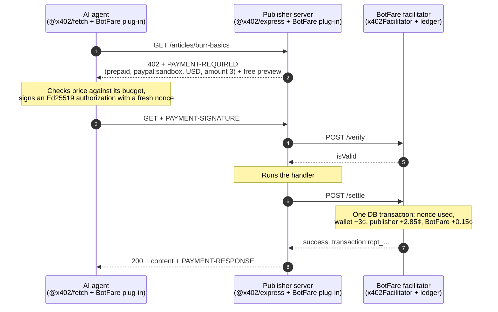
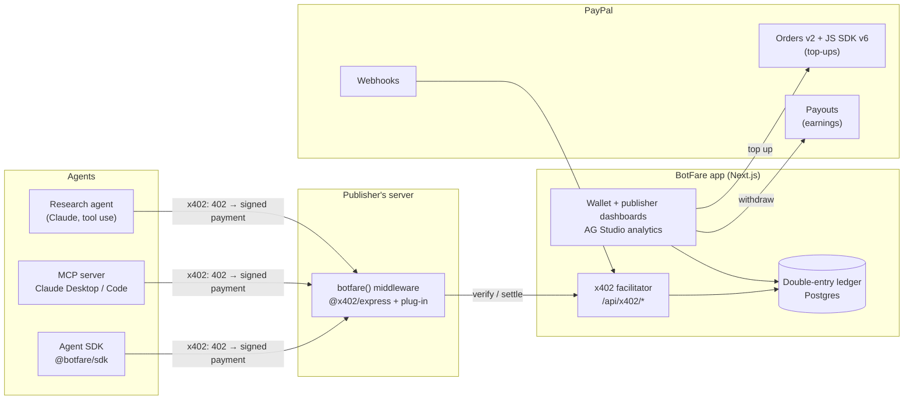

# BotFare

**Every bot pays its fare.**

BotFare is pay-per-request for AI agents, settled on PayPal: **x402 for PayPal's 440 million accounts.**

AI agents read pages and call APIs for free, and the open standard for paying per request, [x402](https://github.com/x402-foundation/x402), settles in stablecoins on blockchains. PayPal is a Premier member of the x402 Foundation, yet x402 has no way to settle to a PayPal account. BotFare adds one: a new x402 payment type, scheme `prepaid` on network `paypal:sandbox`, that plugs into the official x402 SDK.

- **Publishers and API owners** add one line of middleware, set a price per page or call, and get paid through **PayPal Payouts**.
- **Agent owners** top up a balance with **PayPal Checkout** and give each agent a key with a budget: daily cap, per-request max, allowed sites.
- **Agents** pay a few cents per request with a signed x402 payment. Humans browsing the same site are never charged.

Built for the [PayPal AI Hackathon](https://paypalaihackathon.devpost.com/), November 2026.

## Why it needs a ledger

A PayPal payment costs at least 49¢ in fees (3.49% + $0.49), and even PayPal's micropayments rate is 4.99% + 9¢. Neither works for a 3¢ article. BotFare batches the PayPal side and settles each request in its own ledger:

| | PayPal per read | Through BotFare |
| --- | --- | --- |
| Agent owner | ~49¢ fee on every 3¢ read | One $5.00 top-up, one **$0.66** fee (measured in sandbox), about 166 reads |
| Publisher | One payment per read | One Payouts batch for all of a day's earnings |
| Each request | A full PayPal transaction | A signed authorization, a ledger posting and a receipt |

## How a paid request works



Settlement happens only after the publisher's handler succeeds, so an agent is never charged for a failed response. Each authorization is single-use and expires within 60 seconds.

## Architecture



## The x402 plug-in

[`packages/x402-paypal`](packages/x402-paypal) implements all three sides of the x402 V2 SDK's plug-in interfaces for the `prepaid` scheme on `paypal:*` networks:

| Side | Class | What it does |
| --- | --- | --- |
| Agent | `PrepaidPayPalClient` (`SchemeNetworkClient`) | Signs an Ed25519 JWS over scheme, network, asset, amount, payee and a fresh nonce |
| Publisher | `PrepaidPayPalServer` (`SchemeNetworkServer`) | Turns `"$0.03"` into `{ asset: "USD", amount: "3" }`; uses the verify, serve, settle flow |
| Facilitator | `PrepaidPayPalFacilitator` (`SchemeNetworkFacilitator`) | Checks the signature, expiry and field binding, then charges through a ledger port |

A decoded `PAYMENT-REQUIRED` header from the official `@x402/express` middleware looks like this:

```json
{
  "x402Version": 2,
  "resource": { "url": "https://demo.example/articles/burr-basics", "description": "Burr grinders, explained", "mimeType": "text/html" },
  "accepts": [
    { "scheme": "prepaid", "network": "paypal:sandbox", "amount": "3", "asset": "USD", "payTo": "site_demo", "maxTimeoutSeconds": 60, "extra": {} }
  ]
}
```

It follows the precedent of Cloudflare's `batch-settlement` scheme (`cloudflare:402`, USD in cents, Ed25519-signed agents) in the x402 repo.

## PayPal APIs used

| Need | PayPal API | Where |
| --- | --- | --- |
| Top up an agent wallet | Orders v2 (`payment_source.paypal.experience_context`), JS SDK v6 | [`packages/paypal`](packages/paypal), wallet page |
| Book PayPal's fee in the ledger | Capture `seller_receivable_breakdown.paypal_fee` | [`packages/paypal`](packages/paypal) |
| Pay publishers | Payouts (`sender_batch_id` idempotency, batch and item status) | [`packages/paypal`](packages/paypal) |
| Keep money state in sync | Webhooks + `verify-webhook-signature` | [`packages/paypal`](packages/paypal) |
| Refund unused balance | Capture refunds | [`packages/paypal`](packages/paypal) |
| Verified publisher identity | Log in with PayPal | publisher sign-in |

Everything runs in the PayPal **sandbox only**.

## Status

| Piece | State |
| --- | --- |
| x402 plug-in (`prepaid` on `paypal:sandbox`) | ✅ Works end to end with the official `@x402/express`, `@x402/fetch` and `x402Facilitator` 2.30.0 |
| PayPal client: orders, capture, refunds, Payouts, webhooks | ✅ Built and tested |
| Sandbox spikes: OAuth, $5 top-up, $0.25 Payout, JWS, x402 | ✅ All pass ([results](docs/SPIKE_RESULTS.md)) |
| Postgres ledger, facilitator API, middleware, agent SDK, demo publisher | 🚧 In progress |
| Wallet and publisher dashboards, Payouts UI, webhooks | ⏳ Planned |
| Research agent, MCP server, judge mode, deployment | ⏳ Planned |

The full proposal, decisions and day-by-day plan are in [`docs/PLAN.md`](docs/PLAN.md).

## Repository layout

```text
packages/x402-paypal   the x402 plug-in: client, server and facilitator parts, JWS helpers, ledger port
packages/paypal        typed PayPal REST client (sandbox only)
packages/core          Postgres schema and double-entry ledger (in progress)
packages/express       botfare() middleware for publishers (in progress)
packages/sdk           agent SDK on @x402/fetch (in progress)
apps/web               Next.js: facilitator API, dashboards, research agent (in progress)
apps/demo              demo publisher site and API (in progress)
scripts/spike          Day-0 PayPal and x402 spikes
docs                   plan, spike results, protocol notes
```

## Run it locally

You need Node 22+, pnpm 10 and Docker.

```bash
pnpm install
cp .env.example .env    # add your PayPal sandbox app's client ID and secret
pnpm db:up              # Postgres 17 in Docker
pnpm test               # unit tests
pnpm spike:05           # x402 plug-in end to end; no PayPal account needed
```

With PayPal sandbox credentials in `.env`:

```bash
pnpm spike:01           # OAuth
pnpm spike:02           # $5 top-up: approve the printed link as a sandbox buyer
pnpm spike:03           # $0.25 Payouts batch to PUBLISHER_PAYPAL_EMAIL
```

## Built with

PayPal (Orders v2, JS SDK v6, Payouts, Webhooks, Log in with PayPal) · x402 V2 SDK · Anthropic Claude · TypeScript · Next.js · Express · Postgres · Drizzle · jose · zod · Docker · Render · AG Studio · Claude Code, with PayPal's Claude Code plugin and APIMatic ContextMatic.

## License

[MIT](LICENSE)
