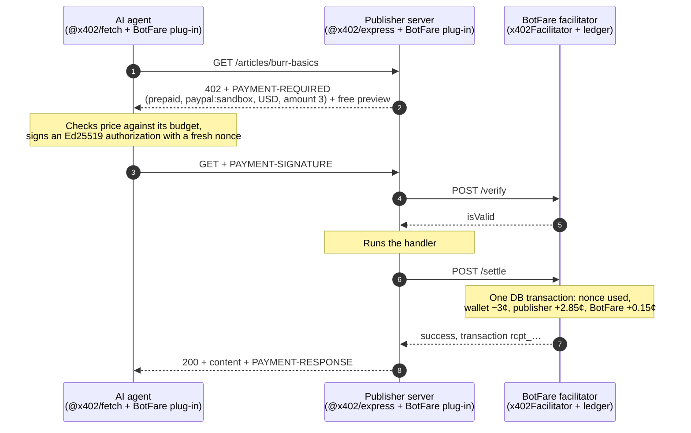
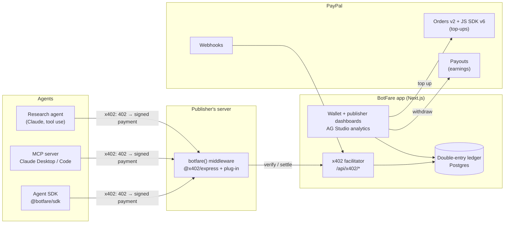

# BotFare

**Every bot pays its fare.**

BotFare is pay-per-request for AI agents, settled on PayPal: **x402 for PayPal's 440 million accounts.**

AI agents read pages and call APIs for free, and the open standard for paying per request, [x402](https://github.com/x402-foundation/x402), settles in stablecoins on blockchains. PayPal is a Premier member of the x402 Foundation, yet x402 has no way to settle to a PayPal account. BotFare adds one: a new x402 payment type, scheme `prepaid` on network `paypal:sandbox`, that plugs into the official x402 SDK.

- **Publishers and API owners** add one line of middleware, set a price per page or call, and get paid through **PayPal Payouts**.
- **Agent owners** top up a balance with **PayPal Checkout** and give each agent a key with a budget: daily cap, per-request max, allowed sites.
- **Agents** pay a few cents per request with a signed x402 payment. Humans browsing the same site are never charged.

Built for the [PayPal AI Hackathon](https://paypalaihackathon.devpost.com/), November 2026.

## Why it needs a ledger

A PayPal payment costs at least 49¢ in fees (3.49% + $0.49), and even PayPal's micropayments rate is 4.99% + 9¢. Neither works for a 3¢ article. BotFare batches the PayPal side and settles each request in its own ledger:

| | PayPal per read | Through BotFare |
| --- | --- | --- |
| Agent owner | ~49¢ fee on every 3¢ read | One $5.00 top-up, one **$0.66** fee (measured in sandbox), about 166 reads |
| Publisher | One payment per read | One Payouts batch for all of a day's earnings |
| Each request | A full PayPal transaction | A signed authorization, a ledger posting and a receipt |

## How a paid request works



Settlement happens only after the publisher's handler succeeds, so an agent is never charged for a failed response. Each authorization is single-use and expires within 60 seconds.

## Architecture



## The x402 plug-in

[`packages/x402-paypal`](packages/x402-paypal) implements all three sides of the x402 V2 SDK's plug-in interfaces for the `prepaid` scheme on `paypal:*` networks:

| Side | Class | What it does |
| --- | --- | --- |
| Agent | `PrepaidPayPalClient` (`SchemeNetworkClient`) | Signs an Ed25519 JWS over scheme, network, asset, amount, payee and a fresh nonce |
| Publisher | `PrepaidPayPalServer` (`SchemeNetworkServer`) | Turns `"$0.03"` into `{ asset: "USD", amount: "3" }`; uses the verify, serve, settle flow |
| Facilitator | `PrepaidPayPalFacilitator` (`SchemeNetworkFacilitator`) | Checks the signature, expiry and field binding, then charges through a ledger port |

A decoded `PAYMENT-REQUIRED` header from the official `@x402/express` middleware looks like this:

```json
{
  "x402Version": 2,
  "resource": { "url": "https://demo.example/articles/burr-basics", "description": "Burr grinders, explained", "mimeType": "text/html" },
  "accepts": [
    { "scheme": "prepaid", "network": "paypal:sandbox", "amount": "3", "asset": "USD", "payTo": "site_demo", "maxTimeoutSeconds": 60, "extra": {} }
  ]
}
```

It follows the precedent of Cloudflare's `batch-settlement` scheme (`cloudflare:402`, USD in cents, Ed25519-signed agents) in the x402 repo.

## PayPal APIs used

| Need | PayPal API | Where |
| --- | --- | --- |
| Top up an agent wallet | Orders v2 (`payment_source.paypal.experience_context`), JS SDK v6 | [`packages/paypal`](packages/paypal), wallet page |
| Book PayPal's fee in the ledger | Capture `seller_receivable_breakdown.paypal_fee` | [`packages/paypal`](packages/paypal) |
| Pay publishers | Payouts (`sender_batch_id` idempotency, batch and item status) | [`packages/paypal`](packages/paypal) |
| Keep money state in sync | Webhooks + `verify-webhook-signature` | [`packages/paypal`](packages/paypal) |
| Refund unused balance | Capture refunds | [`packages/paypal`](packages/paypal) |
| Verified publisher identity | Log in with PayPal | publisher sign-in |

Everything runs in the PayPal **sandbox only**.

## Status

| Piece | State |
| --- | --- |
| x402 plug-in (`prepaid` on `paypal:sandbox`) | ✅ Works end to end with the official `@x402/express`, `@x402/fetch` and `x402Facilitator` 2.30.0 ([spec](docs/PROTOCOL.md)) |
| PayPal client: orders, capture, refunds, Payouts, webhooks | ✅ Built and tested |
| Sandbox spikes: OAuth, $5 top-up, $0.25 Payout, JWS, x402 | ✅ All pass ([results](docs/SPIKE_RESULTS.md)) |
| Postgres double-entry ledger, `PostgresPrepaidLedger`, refunds | ✅ Built; DB tests cover concurrency, caps, replays and refunds |
| Facilitator API in the Next.js app (`/api/x402/*`, site config, health) | ✅ Built; site Basic auth |
| `botfare()` publisher middleware, agent SDK (`getOffer`, paid `fetch`, spend cap, wire events) | ✅ Built |
| Crema Notes demo publisher (articles + brew-ratio API) | ✅ Built |
| `pnpm seed` + `pnpm e2e`: Phase 1 on real processes and Postgres | ✅ All checks pass |
| Render Blueprint ([`render.yaml`](render.yaml)) | ✅ Written, not yet deployed |
| Wallet and publisher dashboards, PayPal top-up and Payouts UI, webhooks | ⏳ Next |
| Research agent, MCP server, judge mode, deployment | ⏳ Planned |

The full proposal, decisions and day-by-day plan are in [`docs/PLAN.md`](docs/PLAN.md).

## Repository layout

```text
packages/x402-paypal   the x402 plug-in: client, server and facilitator parts, JWS helpers, ledger port, in-memory ledger
packages/contracts     types and helpers shared across every HTTP boundary: IDs, site config, pricing rules, agent keys
packages/core          Drizzle schema and migrations, Postgres double-entry ledger, PostgresPrepaidLedger, services
packages/express       botfare({ siteId, siteSecret }): one-line publisher middleware on @x402/express
packages/sdk           createBotFareAgent(): getOffer() and a paying fetch on @x402/fetch
packages/paypal        typed PayPal REST client (sandbox only)
apps/web               Next.js: x402 facilitator API (/api/x402/*), site config, health; dashboards next
apps/demo              Crema Notes: fictional coffee site and brew-ratio API behind botfare()
scripts/seed.ts        demo publisher, site, $5 wallet and agent key, written to .env
scripts/e2e.ts         Phase 1 end to end: web app + demo + Postgres, PASS/FAIL per check
scripts/spike          Day-0 PayPal and x402 spikes
docs                   plan, protocol spec, spike results
render.yaml            Render Blueprint: botfare-web, botfare-demo, Postgres 17
```

## Run it locally

You need Node 22+ (the repo pins 24 LTS in `.node-version`; Render uses it too, and Node 25+ no longer bundles the Corepack the Render build enables), pnpm 10 and Docker.

```bash
pnpm install
cp .env.example .env    # PayPal sandbox keys are only needed for the PayPal spikes for now
pnpm db:up              # Postgres 17 in Docker (botfare and botfare_test databases)
pnpm db:migrate         # apply the Drizzle migrations to DATABASE_URL
pnpm seed               # demo publisher, Crema Notes site, $5.00 wallet, agent key -> .env
pnpm e2e                # start the app and the demo, pay for content, check every ledger movement
```

`pnpm e2e` starts the BotFare app (`next dev` on :3000, reused if it is already running) and the demo (:4000). It then checks:

- a human reads an article free;
- `getOffer` shows 3¢ with a preview and moves no money;
- the agent pays and gets a receipt;
- the ledger moved exactly (wallet −30,000 micro-dollars, publisher +28,500, BotFare +1,500);
- a replayed payment is refused with `nonce_used` and the original receipt;
- a 50¢ article is refused by the 10¢ cap before anything is signed;
- the brew API charges 1¢ to any paying client;
- a refund restores the wallet exactly once;
- the ledger sums to zero.

It exits non-zero on any failure.

To click around yourself:

```bash
pnpm dev:web            # BotFare app on http://localhost:3000 (GET /api/health)
pnpm dev:demo           # Crema Notes on http://localhost:4000, payments on with the seeded site
```

Then open http://localhost:4000 in a browser, where humans read free. Agents get a 402 with a price and a preview:

```bash
curl -i -H 'x-botfare-agent: 1' http://localhost:4000/articles/burr-basics
```

Run `pnpm seed` again whenever you like. It keeps the site secret in `.env` while it still works, so a running demo keeps charging; `pnpm seed --rotate-site-secret` issues a new one (restart `dev:demo` after it).

Checks:

```bash
pnpm typecheck && pnpm lint && pnpm test   # unit tests plus *.db.test.ts against botfare_test
pnpm --filter @botfare/web build
pnpm spike:04 && pnpm spike:05             # JWS and the x402 plug-in; no PayPal account needed
```

With PayPal sandbox credentials in `.env`:

```bash
pnpm spike:01           # OAuth
pnpm spike:02           # $5 top-up: approve the printed link as a sandbox buyer
pnpm spike:03           # $0.25 Payouts batch to PUBLISHER_PAYPAL_EMAIL
```

## Deploy

[`render.yaml`](render.yaml) is a Render Blueprint for three resources:

- `botfare-web`: builds the Next.js app and runs `pnpm db:migrate` before each deploy;
- `botfare-demo`: reaches the app over Render's private network;
- `botfare-db`: Postgres 17.

Node comes from `.node-version` (24 LTS, which still bundles the Corepack the build commands enable).

Secrets are `sync: false`, so Render asks for them when the Blueprint is first applied. Leave `BOTFARE_SITE_ID` and `BOTFARE_SITE_SECRET` empty at that point: the database does not exist yet, and until they are set the demo runs in free mode (`/health` reports `payments: off`) and charges nothing.

Once the first deploy is live, provision the demo site once. `botfare-db` is reachable only on Render's private network, so run the seed from `botfare-web`'s Shell, where `DATABASE_URL` is already set:

```bash
DEMO_ORIGIN=https://<botfare-demo>.onrender.com pnpm seed --print-secrets
```

1. Copy the printed `BOTFARE_SITE_ID` and `BOTFARE_SITE_SECRET` into `botfare-demo` > Environment and save; Render redeploys the demo with payments on.
2. Copy `BOTFARE_AGENT_KEY` into the `.env` of the machine that runs the agent.
3. Check `https://<botfare-demo>.onrender.com/health` reports payments on, then `curl -i -H 'x-botfare-agent: 1' https://<botfare-demo>.onrender.com/articles/burr-basics` returns a 402.

Running the seed again keeps the site secret only if it can see the current one, which the Shell's `.env` holds until the next deploy of `botfare-web`. After a redeploy, pass the values back in (`BOTFARE_SITE_ID=… BOTFARE_SITE_SECRET=… pnpm seed`), or let it issue a new secret and repeat step 1.

## Built with

PayPal (Orders v2, JS SDK v6, Payouts, Webhooks, Log in with PayPal) · x402 V2 SDK · Anthropic Claude · TypeScript · Next.js · Express · Postgres · Drizzle · jose · zod · Docker · Render · AG Studio · Claude Code, with PayPal's Claude Code plugin and APIMatic ContextMatic.

## License

[MIT](LICENSE)
