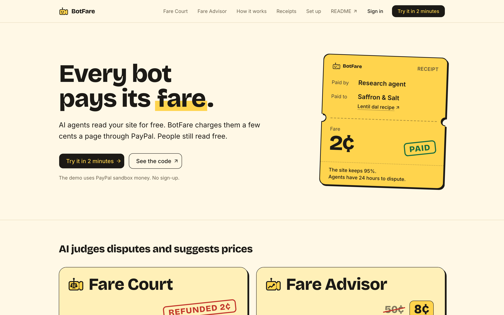
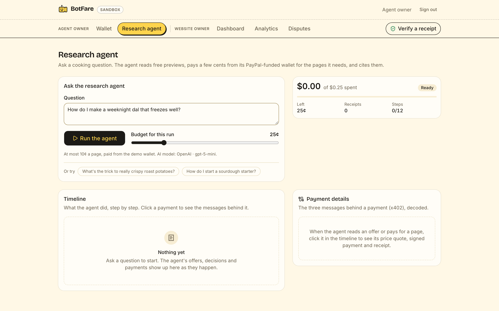
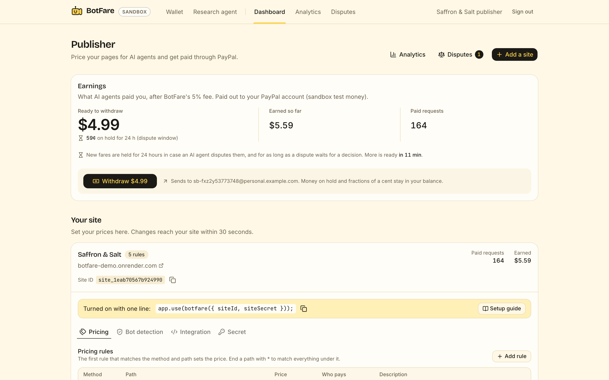

# BotFare

**Every bot pays its fare.**

BotFare lets websites charge AI agents a few cents a page through PayPal, while people keep reading free.

## Try it

- Live app: [botfare-web.onrender.com/judge](https://botfare-web.onrender.com/judge). Three steps, no sign-up, PayPal sandbox test money.
- Demo website: [botfare-demo.onrender.com](https://botfare-demo.onrender.com), Saffron & Salt, a made-up recipe blog.
- Check any receipt: [botfare-web.onrender.com/verify](https://botfare-web.onrender.com/verify).
- Video (2:58): [youtu.be/Opl81NyyIvw](https://youtu.be/Opl81NyyIvw)



## The problem

- AI answers take the clicks that paid for the writing. With a Google AI Overview on the page, people click a result on 8% of visits instead of 15% ([Pew Research Center, 2025](https://www.seroundtable.com/pew-google-ai-overviews-39808.html)).
- A PayPal payment costs at least 49¢ in fees (3.49% + $0.49). A 2¢ page cannot pay that on every read.
- [x402](https://github.com/x402-foundation/x402), the open standard for paying per request, settles in stablecoins. PayPal is a Premier member of the x402 Foundation, yet x402 has no way to pay into PayPal's 440 million accounts.

## How it works

1. A website adds one line of middleware and sets prices in the BotFare dashboard.
2. People read free. An AI agent gets an HTTP 402 with the price and a free preview.
3. The agent's owner tops up a USD wallet once with PayPal and gives each agent a key with a budget.
4. The agent signs a payment for the page. BotFare checks it, the page is served, then the fare settles in BotFare's ledger. A failed page is never charged.
5. The website keeps 95% and BotFare keeps 5%. Earnings go out through PayPal Payouts.
6. BotFare signs a receipt for every payment, delivery and refund. Anyone can check it on `/verify`.
7. AI makes the calls too small for a person. The agent buys or skips each page. Fare Court refunds a page that wasn't as promised. Fare Advisor suggests prices. Code, not the model, moves the money.

The one line for a website (Express):

```ts
app.use(botfare({ siteId: process.env.BOTFARE_SITE_ID!, siteSecret: process.env.BOTFARE_SITE_SECRET! }));
```

One $5 top-up pays one PayPal fee ($0.66, measured in sandbox) and covers 250 recipes at 2¢. Details: [why it needs a ledger](docs/TECHNICAL.md#why-it-needs-a-ledger) and [how a paid request works](docs/TECHNICAL.md#how-a-paid-request-works).

## What judges can try in 2 minutes

Open [/judge](https://botfare-web.onrender.com/judge). Each button signs you in as the right demo user.

1. **Watch an AI agent pay.** Ask a cooking question. The agent pays 2¢ to 8¢ for each page worth reading, in about 20 seconds. See the **Payment details** and **Check the receipts yourself** panels, then open a receipt on `/verify`. Ask about a sourdough starter to see Fare Court refund a page that wasn't as promised.
2. **See what the website earns.** Saffron & Salt's dashboard shows earnings, Withdraw now to PayPal, Fare Advisor with **Apply**, Disputes, and charts in AG Studio.
3. **Fund an agent with PayPal.** Top up $5 with the PayPal button and the sandbox test account shown on `/judge`.

| The research agent | The website's dashboard |
| --- | --- |
|  |  |

## How BotFare meets the judging criteria

| Criterion | What to look at |
| --- | --- |
| Technological Implementation | An x402 V2 plug-in for the official `@x402` SDK 2.30.0: scheme `prepaid` on network `paypal:sandbox` ([`packages/x402-paypal`](packages/x402-paypal), [protocol](docs/PROTOCOL.md)). Five PayPal APIs ([below](#paypal-apis-used)). A double-entry ledger ([`packages/core`](packages/core)). AI with policy in code: [Fare Court](apps/web/src/lib/server/fare-court.ts), [Fare Advisor](apps/web/src/lib/server/fare-advisor.ts), the [research agent](docs/TECHNICAL.md#the-research-agent). 581 unit tests, 277 database tests and an end-to-end run. |
| Design | The `/judge` tour, one-line setup, the wallet's PayPal button, the agent's Payment details and receipts panels, `/verify`, and [AG Studio analytics](apps/web/src/components/analytics) with a custom theme, custom widgets and an AI assistant. |
| Potential Impact | Small websites and API owners earn from AI traffic through PayPal accounts they already have. Agent owners pay one PayPal fee per top-up, not per page. |
| Quality of the Idea | x402 for PayPal's 440 million accounts. AI on every side of the fare, for decisions too small for a person ([details](docs/TECHNICAL.md#ai-on-every-side-of-the-fare)). Signed receipts anyone can check ([details](docs/TECHNICAL.md#signed-receipts)). |
| Presentation | The `/judge` tour, the one-command [Docker stack](docs/TECHNICAL.md#run-everything-in-docker), the video, and limits written down plainly in [TECHNICAL.md](docs/TECHNICAL.md). |

## PayPal APIs used

All calls go to the PayPal **sandbox** only. Every POST sends a `PayPal-Request-Id`, so a retry never pays twice.

| PayPal API | What for | Where |
| --- | --- | --- |
| Orders v2 (`experience_context`) + JS SDK v6 | Top up an agent wallet | [create order](apps/web/src/app/api/wallet/topups/route.ts), [wallet button](apps/web/src/components/wallet/top-up-card.tsx), [`client.ts`](packages/paypal/src/client.ts) |
| Capture (`seller_receivable_breakdown`) | Book PayPal's fee in the ledger | [capture route](apps/web/src/app/api/wallet/topups/%5BorderId%5D/capture/route.ts) |
| Payouts (`sender_batch_id`) | Pay websites (Withdraw now and a daily batch) | [Withdraw now](apps/web/src/app/api/publisher/payouts/route.ts), [daily batch](scripts/payouts.ts) |
| Webhooks + `verify-webhook-signature` | Keep captures and payouts in sync | [webhook route](apps/web/src/app/api/paypal/webhook/route.ts) |
| Log in with PayPal | Sign websites in by their verified PayPal email | [start](apps/web/src/app/api/auth/paypal/start/route.ts), [callback](apps/web/src/app/api/auth/paypal/callback/route.ts) |

## Run it locally

You need Node 22+ (24 LTS pinned in `.node-version`), pnpm 10 and Docker.

```bash
pnpm install
cp .env.example .env    # add PayPal sandbox keys and one AI provider key
pnpm db:up              # Postgres 17 in Docker
pnpm db:migrate
pnpm seed               # demo users, Saffron & Salt, a $5 wallet and an agent key -> .env
pnpm seed:traffic       # two weeks of demo traffic for the dashboards
pnpm dev:web            # BotFare on http://localhost:3000/judge
pnpm dev:demo           # Saffron & Salt on http://localhost:4000
```

Or run the whole stack in Docker, then open http://localhost:3300/judge:

```bash
docker compose -f docker-compose.full.yml -p botfare-judge up --build -d --wait
```

Checks: `pnpm typecheck && pnpm lint && pnpm test`, and `pnpm e2e` for the end-to-end run. More in [TECHNICAL.md](docs/TECHNICAL.md#run-it-locally).

The packages are not on npm yet. To add BotFare to your own site or agent, see [Use BotFare in your app](docs/TECHNICAL.md#use-botfare-in-your-app).

## Deploy

[`render.yaml`](render.yaml) is a Render Blueprint: the app, the demo website, a daily Payouts cron, a weekly demo-traffic cron and Postgres 17.
Apply it, fill in the secrets Render asks for, then seed the demo site from the app's Shell.
Step by step: [TECHNICAL.md, Deploy](docs/TECHNICAL.md#deploy).

## More

- [docs/TECHNICAL.md](docs/TECHNICAL.md): agent detection, the research agent and any model, Fare Court, Fare Advisor, signed receipts, MCP server, judge mode, architecture, tests and deploy.
- [docs/PROTOCOL.md](docs/PROTOCOL.md): the `prepaid` x402 scheme.
- [packages/mcp](packages/mcp/README.md): pay BotFare sites from Claude Desktop or Claude Code.
- [docker/README.md](docker/README.md): the one-command judge stack.
- Packages: [`x402-paypal`](packages/x402-paypal), [`express`](packages/express), [`sdk`](packages/sdk), [`contracts`](packages/contracts), [`core`](packages/core), [`paypal`](packages/paypal).

Built for the [PayPal AI Hackathon](https://paypalaihackathon.devpost.com/), November 2026. Pay the fare, pal.

## License

[MIT](LICENSE)
