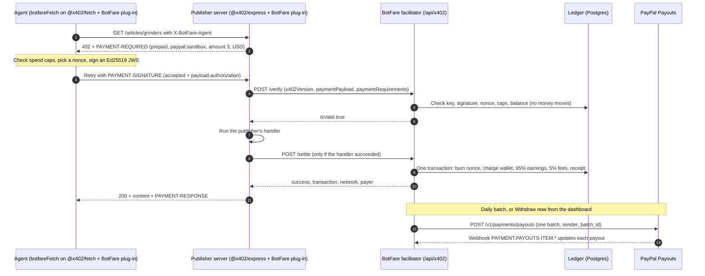
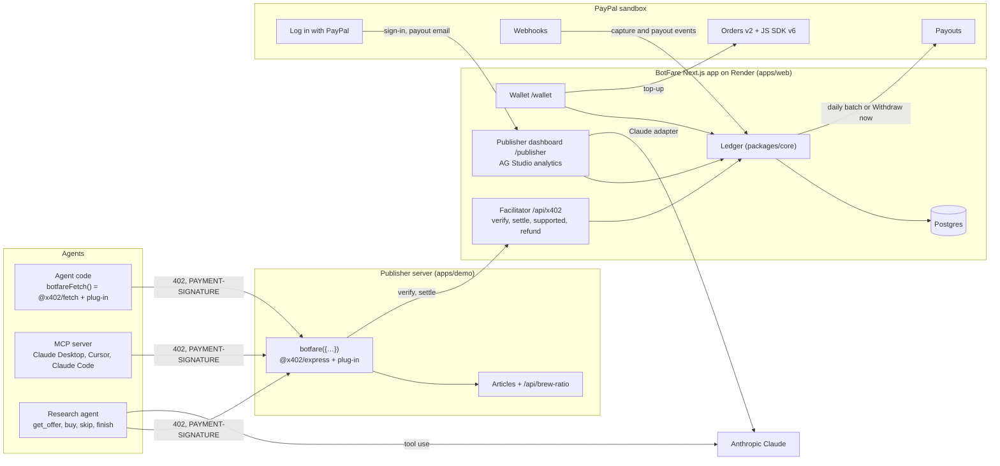

# BotFare — Pay-per-request for AI agents on PayPal: Proposal & Build Plan

Nov 8, 2026 · @Sajjad

This plan replaces the spending-controls plan for the PayPal AI Hackathon; spending controls stay a possible add-on if time allows. Revised on 8 Nov after research into the hackathon rules, x402 V2, PayPal's APIs and AG Studio; where an older note disagrees, "Decisions (8 Nov)" wins.

## Summary

We are building **BotFare**: pay-per-request for AI agents, settled through PayPal. Tagline: *Every bot pays its fare.*

- **Publishers and API owners** add one line of middleware, set a price per page or call in the dashboard, and get paid through PayPal Payouts.
- **Agent owners** top up a balance with PayPal, give each agent a key with a budget, and let it pay a few cents per request through an SDK or an MCP server.
- **BotFare** sits in the middle: a real x402 V2 payment type for PayPal (scheme `prepaid` on network `paypal:sandbox`, a plug-in for the official `@x402/*` SDK), a ledger that makes cents worth settling, and Payouts in batches.
- **Pitch:** *BotFare: x402 for PayPal's 440 million accounts.* No crypto wallet. "x402 runs on Base and Solana. BotFare adds PayPal."
- **Deadline:** Nov 12, 2026, 12:00 pm PST (Fri 13 Nov, 1:30 am IST); we aim to submit by Thu 8 pm IST. Built solo with Claude Code.
- **Prize targets:** one of the five $5,000 honourable mentions (Most Creative, Best Use of Agentic Commerce or Best Use of PayPal + AI are our best fits), stretch 1st place ($12,000), plus one sponsor prize: AG Grid (up to $5,000), APIMatic ($1,000) or Render (credits). A project can win one grand prize *or* one honourable mention, plus one sponsor prize.

## Decisions (8 Nov)

These come from the research on 8 Nov and override anything older in this doc or in `CLAUDE.md`.

**Ground rules:**

- **x402:** the PayPal payment type is a plug-in for the official x402 SDK (`@x402/*`, pinned to exactly 2.30.0) from the start. x402 only carries payments between agent and site; everything that makes BotFare valuable is the same either way: wallet, keys, budgets, ledger, PayPal top-ups, Payouts, dashboards, MCP server.
- **Sponsor prizes:** aim for AG Grid (publisher analytics in AG Studio) as well as Render and APIMatic.
- **Docker:** Postgres runs in Docker; the apps run natively.
- **GitHub:** the repo is private until submission, then made public.
- **Accounts:** created just in time, on the day they are first needed.

**The 14 changes:**

1. **A real x402 plug-in, not an imitation.** The scheme is `prepaid` on network `paypal:sandbox`; x402 names schemes after the mechanism and networks after the payment rail, as in Cloudflare's `batch-settlement` on `cloudflare:402`. Publishers run the official `@x402/express` and agents the official `@x402/fetch`, each with our plug-in registered.
2. **The agent picks the nonce** inside the client plug-in, as x402's `exact` scheme does. The facilitator enforces single use per key and a 60-second expiry.
3. **Settle only after a successful response,** following the SDK's verify, serve, settle order, so an agent is never charged for a failed response. This replaces settle-then-refund-on-5xx; refunds become a publisher action in the dashboard.
4. **One demo publisher service** (`apps/demo`: articles plus a brew-ratio API) instead of two: one Render service, one set of content.
5. **Prices live in the dashboard.** The one-line `botfare({…})` wrapper fetches them and rebuilds the x402 route config when they change.
6. **Auth is demo personas for judges plus Log in with PayPal**, which also gives a verified payout email. No magic links.
7. **The AI's buying is visible.** `get_offer` reads the 402 for free (price, title, preview); `buy` and `skip` each take a reason. Hard caps live in two places: the SDK's spend controls and the facilitator's per-key checks. The demo scripts one cheap but irrelevant page the AI skips and one 50¢ page the 10¢ cap blocks, so both its judgement and the guardrail show on screen, the same way every time.
8. **A wire inspector next to the agent** shows the decoded `PAYMENT-REQUIRED`, then the signed payment, then `PAYMENT-RESPONSE`. It scores on Tech and on Best Demo Delivery.
9. **More of PayPal where it fits:** JS SDK v6, `experience_context`, the capture's PayPal fee booked in the ledger, `sender_batch_id` idempotency, webhooks, Log in with PayPal.
10. **Publisher analytics in AG Studio**, not a second chart UI: a BotFare theme, a "live paid requests" custom widget and a payout widget, a responsive layout, and a Claude adapter so a publisher can ask "which pages earn most from agents?"
11. **Deploy on Monday, not Tuesday,** on paid Render plans from the credits. Free services sleep and free Postgres expires (check the current terms at deploy time), while judging runs to Dec 15.
12. **Write for AI judges.** The README and Devpost text map features to the five criteria and link each PayPal API to its code; `docs/PROTOCOL.md` writes up the `prepaid` scheme on `paypal:*` in x402 spec style.
13. **Record B-roll the moment top-up and payout work on Tuesday,** so a sandbox hiccup on Thursday can't sink the video.
14. **The MCP server stays a "should"**, built on the same SDK and first up on Wednesday evening.

**Fallback rule:** spike 05 on Sunday has a 3-hour timebox. If the plug-in can't complete a paid request through the official `@x402/express` and `@x402/fetch` in that time, we fall back to our own Express middleware and SDK fetch wrapper. They speak the same V2 headers and JSON, reuse the plug-in's JWS code and call the same facilitator endpoints; only those two thin layers change. We build the fallback only if the plug-in route blocks us.

## Decisions (9 Nov): AI on every side of the fare

**Why AI belongs in BotFare, not bolted on.** Micropayments have failed for 25 years because every tiny payment needs a decision that costs more human attention than the payment is worth: Nick Szabo's ["Micropayments and Mental Transaction Costs"](https://nakamotoinstitute.org/micropayments-and-mental-transaction-costs/) (1999) and Clay Shirky's "The Case Against Micropayments" (2000). x402 removes the technical cost and BotFare's batching removes PayPal's fee; the decision cost remains at every seat. **BotFare puts AI on the decisions that are too small for a human, and keeps money movement in code.**

| Seat | The micro-decision | AI in BotFare |
| --- | --- | --- |
| Agent (buyer) | Is this page worth 3¢? | Research agent and MCP: Claude reads the free offer, buys or skips with a reason |
| Publisher | What should this page cost an AI? | **Fare Advisor**: prices from what agents say and do |
| BotFare (referee) | Was that 3¢ page what was promised? | **Fare Court**: AI arbitration of micro-disputes |
| Agent owner | How much may my agent spend, and where? | Caps today; plain-English allowance later (backlog) |

15. **Fare Court: PayPal-style Buyer Protection for purchases too small for a human to dispute.**
    - Proof of delivery: the publisher's `botfare()` middleware attests a SHA-256 digest (RFC 9530 `Content-Digest`) of the body it actually delivered for each receipt, and declares the offer (title and preview) in the payment requirements at settle time. The agent cannot fake content; the publisher cannot deny it.
    - The agent files a dispute signed with its key (Web Bot Auth) within 24 hours, with the delivered content; BotFare checks the digest.
    - Claude compares what was declared with what was delivered and returns a zod-validated verdict. Policy lives in code: a confident "not as described" refunds instantly through the ledger's existing refund; anything uncertain goes to the publisher's Disputes tab with the AI's reasoning; dispute-rate limits per key stop "dispute everything".
    - Built (8 Nov evening): the shared demo research key that every judge's run uses gets 200 disputes a day and no dispute-rate rule (other keys keep 10 a day and the 20% rule), so one judge's runs cannot turn instant refunds off for the next. Without `ANTHROPIC_API_KEY` every dispute goes to the publisher.
    - Demo: a Crema Notes page serves a "subscribe to keep reading" stub after payment; the research agent disputes and gets 3¢ back in seconds.
16. **Fare Advisor: "Why didn't the bot buy?"**
    - Signals: offers shown (middleware telemetry of 402s), paid, declined with a reason (an optional free note from agents: the research agent's skip reasons, an MCP `decline_offer`), cited (which receipts an answer actually used), disputed.
    - Claude clusters the reasons per page and recommends price, preview and audience changes with a projected revenue effect; **Apply** updates the pricing rule and reaches the middleware within 30 s.
    - "Citations are the new clicks": publishers see how often each paid page was used in an AI answer, the replacement for the clicks AI summaries took away.
    - Demo: "0 of 23 agents bought Premium roundup at 50¢; 14 said thin listicle. Suggested 8¢." Apply, and the next agent run buys it.
17. **Allowance (plain-English budgets, approvals, Vault, authorize-and-void undo window) moves to the backlog** and to "What's next" on Devpost; full Allowance is a second product domain and would dilute the x402 story this week.

## Decisions (9 Nov): signed receipts

18. **Signed receipts: proof of payment, delivery and sourcing.** BotFare already proves agents and publishers are honest (signed payments, signed agent requests, delivery digests); signed receipts let anyone check BotFare too, without asking its database.
    - At settlement BotFare signs a **payment statement** (Ed25519 JWS, `typ: botfare-receipt+jwt`): receipt, payer key, site, URL, amount, 95/5 split, time, detection signal. It travels in the x402 `PAYMENT-RESPONSE` (`extra.botfareReceipt`). When the publisher attests the delivered bytes, BotFare signs a **delivery statement** (receipt + RFC 9530 content digest); a refund gets a signed **refund statement**.
    - Public keys are published as a JWKS; verification works offline in Node and in the browser (`@botfare/contracts/receipts`), on a public `/verify` page, through `verifyReceipt()` in the SDK, and in the MCP tools.
    - The research agent's answer carries a **sources manifest**; a "Verify sources" panel checks, in the browser, that each cited page was paid (BotFare signature), delivered (signed digest) and that the bytes the agent read match. "This answer paid for its sources, and you can verify every one."
    - Honest limit: a signed receipt proves BotFare issued it and cannot deny it; it does not prove BotFare never edits history. A tamper-evident ledger (signed Merkle checkpoints) is the stretch for that.
19. **Payout hold for the dispute window (9 Nov).** BotFare holds agent owners' prepaid money (top-ups land in BotFare's PayPal account; every fare and refund is a ledger posting, so disputes are instant). Withdraw now and the daily Payouts batch pay only *cleared* earnings: a fare clears 24 hours after purchase (`DISPUTE_POLICY.windowHours`, plus a 10-minute safety margin) and stays held while a dispute on it is undecided, and refunds of older fares may use only available earnings, so a valid dispute always finds the money. The publisher dashboard shows Available and Clearing.
20. **Any model on the agent side (9 Nov).** x402 does not care which model drives the agent, and neither does BotFare. The research agent, Fare Court, Fare Advisor and the analytics assistant run on Claude by default and on any OpenAI-compatible provider (OpenAI, Gemini, xAI Grok, Groq, OpenRouter incl. free Llama/DeepSeek/Qwen models, local Ollama) through one adapter that presents the Anthropic client shape, so their logic, limits and zod checks are unchanged. `/agent` has a model picker; `AI_PROVIDER` picks the server default.

## Problem

AI agents read pages and call APIs for free, and the one open standard for paying per request can't settle to the payment accounts most people already have.

- **Publishers lose traffic to AI.** With a Google AI summary on the page, people click a result in 8% of visits, against 15% without one ([Pew via SE Roundtable](https://www.seroundtable.com/pew-google-ai-overviews-39808.html)).
- **Per-request payment has no PayPal rail.** x402, the HTTP 402 standard for agent payments, settles in USDC on blockchains. PayPal Holdings is a **Premier member** of the x402 Foundation ([members](https://www.x402.org/members)), yet the [x402 repo](https://github.com/x402-foundation/x402) has no PayPal scheme, network, issue or PR, and its FAQ says fiat is supported "Not natively".
- **PayPal's fees block cents.** Checkout costs 3.49% + 49¢, micropayments pricing 4.99% + 9¢, and an API payout $0.25 ([PayPal fees](https://www.paypal.com/us/business/paypal-business-fees)). Even the micropayment rate costs three times a 3¢ article.
- **The audience is already on PayPal.** PayPal reported 440 million active accounts at the end of September 2026 ([Q3 2026 8-K, Oct 27](https://www.sec.gov/Archives/edgar/data/0001633917/000163391726000086/pypl3q-26earningsrelease.htm)).

## Solution

BotFare has three sides: publishers who earn, agent owners who pay, and the BotFare service that settles between them.

| Side | What they do | What we build |
| --- | --- | --- |
| Publisher or API owner (earns) | Connect PayPal, set prices per page or endpoint, add one line of code, watch AI revenue, refund, withdraw | Publisher dashboard: sites, prices, site keys, copy-paste `botfare({…})` snippet, AG Studio revenue analytics, refunds, payouts |
| Agent owner (pays) | Top up with PayPal, create agent keys with budgets, plug a key into an agent | Wallet: PayPal top-up (JS SDK v6), keys with daily cap, per-request max and allowed sites, receipts list |
| Agent (software) | Requests a page or API, reads the offer, pays the fare, gets the content | `botfareFetch()` SDK (official `@x402/fetch` + our plug-in), MCP server for Claude Desktop and Cursor, demo research agent |
| BotFare (in the middle) | Verifies and settles each request and pays publishers | x402 facilitator (`/verify`, `/settle`, `/supported`) on the official `x402Facilitator`, double-entry ledger, replay protection, PayPal Payouts batches, webhooks, 5% fee |

Humans browsing a publisher's site are never charged; only requests that identify as AI agents or known AI bots get a 402.

## What already exists and our edge

Pay-per-request for AI exists on crypto, cards and enterprise deals, and PayPal's own agent products handle checkout-sized purchases, but nothing charges per request on PayPal; we pitch BotFare as **x402 for PayPal accounts**, not as a new invention.

| Product | What it does | How it pays | On PayPal? |
| --- | --- | --- | --- |
| [x402](https://www.x402.org/writing/x402-v2-launch) (Coinbase, Stripe, Google, Visa; PayPal is a Premier member) | HTTP 402 handshake for agent payments | USDC on blockchains | No PayPal scheme or network |
| Cloudflare `batch-settlement` (x402 scheme) | Per-request payments on network `cloudflare:402`, USD in cents, Ed25519-signed agents | Billed by Cloudflare | No; our closest precedent |
| Cloudflare Pay Per Crawl | Charges AI crawlers on Cloudflare sites | Billed by Cloudflare | No |
| PayPal agent products (ACP in ChatGPT, AP2, Perplexity, Agent Ready) | Agents buy goods at checkout | PayPal | Yes, but checkout-sized, not per request |
| PayMCP | Charges per MCP tool call | Each call is a full PayPal payment | Yes, but full fees per call |
| [Nevermined + Visa](https://financialit.net/news/payments/nevermined-unlocks-autonomous-agent-card-payments-x402-opening-new-market-publishers) (pilot, Apr 2026) | x402 with cards and spending limits for articles, data, APIs | Visa cards | No |
| [TollBit](https://mediacopilot.ai/ai-revenue-platforms-comparison/) | Publishers charge AI companies per 1,000 pages | Not stated | No |
| [Supertab Connect](https://supertab.co/supertab-connect) | Publisher-side licensing for AI (RSL) | Not stated | No |
| [Skyfire](https://www.skyfire.xyz/product) | Agent wallets that pay for sites and APIs | Cards, ACH, USDC | No |

**Our edge:**

- Settles on PayPal: top-ups with PayPal, earnings by PayPal Payouts, so anyone with a PayPal account can pay or earn.
- Speaks real x402 V2: BotFare is a scheme plug-in for the official `@x402/*` SDK, so an x402 server or agent adds PayPal by registering one plug-in next to Base and Solana.
- Open to small publishers and API or MCP developers, not only large publishers or AI companies.
- Batching makes cents viable: thousands of requests become one top-up and one payout.

**Name check:** a web search found no conflicts for "BotFare"; the nearest names are BoltFare and FareBot. USPTO was not searched, so check it before recording. The name avoids PayFare (Payfare Inc., acquired by Fiserv), FarePay (a transit card) and anything with "Pal"; [Faremeter](https://www.startuphub.ai/startups/faremeter), an x402 framework, also uses "fare".

## How a paid request works

An agent pays for a page in one retry: the site asks for 3¢, the agent signs a payment, BotFare verifies it, the page is served, and only then does BotFare settle and the page come back with a receipt.



Only step 9 moves money, and only inside the ledger; PayPal is touched when owners top up and when publishers are paid out. A handler that fails never reaches step 8, so the agent is not charged.

**Setting up each side:**

1. **Publisher:** sign in (demo persona or Log in with PayPal), add a site, set prices, copy the site ID, secret and one-line `botfare({…})` snippet into the server, then watch revenue and withdraw to PayPal.
2. **Agent owner:** sign in, top up with the PayPal button, create a key with a daily cap, per-request max and allowed sites, and give the key to the agent (SDK or MCP server).

## Architecture and stack

One Next.js app on Render holds the wallet, the facilitator, the ledger and the dashboards; publishers run only the x402 middleware with our plug-in, and PayPal is called only for top-ups, sign-in and payouts.



The facilitator is the hot path: every paid request is verified and settled there and writes to the ledger; Claude calls from the research agent and the AG Studio adapter sit in the same app but never touch money.

**Repo layout** (inside `~/Desktop/work/hackathons/paypal/botfare`):

```text
apps/web             Next.js App Router + Tailwind + shadcn/ui: landing, /publisher (with AG Studio), /wallet,
                     /agent, /judge; facilitator /api/x402/{verify,settle,supported} built on x402Facilitator
                     + /refund; /api/paypal/webhook; Log in with PayPal callback
apps/demo            Express 5 demo publisher: original articles + /api/brew-ratio behind @botfare/express
packages/x402-paypal THE PLUG-IN: `prepaid` scheme for paypal:* — client (Ed25519 JWS, agent nonce, USD asset),
                     server (prices -> requirements), facilitator (verify/settle via an injected ledger port); zod types
packages/express     botfare({ siteId, siteSecret }) = agent detection (humans free) + dashboard prices
                     + @x402/express paymentMiddleware with the plug-in
packages/sdk         createBotFareFetch() = @x402/fetch + plug-in + spend controls; getOffer() (free 402 read)
packages/mcp         stdio MCP server on the SDK: get_offer, fetch_paid, wallet_balance, recent_receipts
packages/paypal      typed PayPal REST client, sandbox only
packages/core        Drizzle schema + migrations, ledger, settlement (implements the ledger port), payouts
scripts/spike        Day-0 scripts (scripts/e2e.ts on Monday)
docs/                PLAN.md, SPIKE_RESULTS.md (later PROTOCOL.md, DEVPOST.md, VIDEO_SCRIPT.md)
docker-compose.yml   Postgres 17        CLAUDE.md        (render.yaml on Monday)
```

**Stack:** TypeScript everywhere (strict), Node 26, pnpm 10 workspaces, official `@x402/*` SDK pinned to 2.30.0 (`@x402/express`, `@x402/fetch`, core), Next.js App Router with Tailwind and shadcn/ui, Express 5, Postgres 17 in Docker locally (Render Postgres in production) with Drizzle ORM, jose for Ed25519 signatures, zod, AG Studio (`ag-studio`, `ag-studio-react`) for publisher analytics, Anthropic SDK with tool use (model in `ANTHROPIC_MODEL`), Biome, vitest and tsx, Render for hosting.

## Protocol details

BotFare is an x402 V2 payment type: scheme `prepaid` on network `paypal:sandbox` (`paypal:*` in general), shipped as `packages/x402-paypal`, a plug-in for the official `@x402/*` SDK. The agent signs each payment against its prepaid balance, the publisher's server asks the BotFare facilitator to verify it, serves the content, then settles, and the agent gets the content plus a settlement receipt.

**The plug-in has three parts**, one per SDK role, each registered with `.register("paypal:*", impl)`:

| Role | SDK class | Interface we implement | What it does |
| --- | --- | --- | --- |
| Agent | `x402Client` (used by `@x402/fetch`) | `SchemeNetworkClient.createPaymentPayload` | Picks a nonce, signs the Ed25519 JWS, declares USD via `findDefaultAsset` so spend controls accept it |
| Publisher | `x402ResourceServer` (used by `@x402/express`) | `SchemeNetworkServer.parsePrice`, `enhancePaymentRequirements` | Turns dashboard prices into `accepts[]` entries with the site ID, facilitator URL and preview |
| BotFare | `x402Facilitator` (in `apps/web`) | `SchemeNetworkFacilitator.verify`, `settle` | Checks the signature and limits, then writes the ledger through an injected ledger port |

**One paid request, step by step:**

1. **402 from the publisher.** `botfare({ siteId, siteSecret })` recognises an agent and lets `@x402/express` answer with HTTP 402 and a `PAYMENT-REQUIRED` header: base64 JSON like the example below. Humans pass through free.
2. **Signed payment from the agent.** `botfareFetch()` decodes the 402, the SDK's spend controls check the price, and the client plug-in generates a nonce and signs `{resource, scheme, network, amount, asset, payTo, nonce, iat, exp}` as an Ed25519 compact JWS (key ID in the `kid` header, 60-second expiry). The agent retries with `PAYMENT-SIGNATURE`: base64 JSON that echoes the chosen entry as `accepted` and carries the JWS in `payload.authorization`. The private key never leaves the agent; BotFare stores only the public key.
3. **Verify.** `@x402/express` POSTs `{x402Version, paymentPayload, paymentRequirements}` to `/api/x402/verify`, authenticated with the site secret. The facilitator checks the signature against the key's public key, that the signed fields equal `accepted` and the requirements, that the nonce is unused for that key and not expired, the per-request max, the daily cap, the balance and the allowed sites. No money moves; it returns `{isValid, invalidReason?, payer}`.
4. **Serve.** The publisher's handler runs. If it fails, the middleware does not settle and the agent is never charged.
5. **Settle.** For a successful response, `@x402/express` POSTs the same body to `/api/x402/settle`. The facilitator repeats the checks and, in one database transaction, burns the nonce, writes the ledger entries and a receipt. Settlement is idempotent by (key, nonce). It returns `{success, transaction, network, payer}`, which the middleware sends back as `PAYMENT-RESPONSE` with the 200.
6. **Discovery.** `GET /api/x402/supported` lists `{x402Version: 2, scheme: "prepaid", network: "paypal:sandbox"}`, which the resource server checks at startup.
7. **Refunds are a publisher action.** A publisher can refund a receipt from the dashboard; `/api/x402/refund` is a BotFare extension behind publisher auth, not part of the x402 handshake.

**Example `PAYMENT-REQUIRED` (decoded):**

```json
{
  "x402Version": 2,
  "resource": {
    "url": "https://brewlab.example/articles/grinders",
    "description": "Full article: choosing an espresso grinder",
    "mimeType": "text/html"
  },
  "accepts": [{
    "scheme": "prepaid",
    "network": "paypal:sandbox",
    "amount": "3",
    "asset": "USD",
    "payTo": "site_8f2a",
    "maxTimeoutSeconds": 60,
    "extra": {
      "facilitator": "https://<botfare-host>/api/x402",
      "decimals": 2,
      "title": "Choosing an espresso grinder under $200",
      "preview": "First 200 characters..."
    }
  }]
}
```

`amount` is in atomic units of the asset, so `"3"` with `asset: "USD"` is 3¢; `payTo` is the publisher's site ID, and the ledger maps it to the publisher's earnings.

**Example `PAYMENT-SIGNATURE` (decoded):**

```json
{
  "x402Version": 2,
  "resource": { "url": "https://brewlab.example/articles/grinders" },
  "accepted": {
    "scheme": "prepaid",
    "network": "paypal:sandbox",
    "amount": "3",
    "asset": "USD",
    "payTo": "site_8f2a",
    "maxTimeoutSeconds": 60,
    "extra": { "facilitator": "https://<botfare-host>/api/x402", "decimals": 2 }
  },
  "payload": {
    "authorization": "<Ed25519 compact JWS: kid = key ID; claims resource, scheme, network, amount, asset, payTo, nonce, iat, exp>"
  }
}
```

**Example `PAYMENT-RESPONSE` (decoded):** `{"success": true, "transaction": "rcpt_41d9", "network": "paypal:sandbox", "payer": "key_7c20"}`.

**Errors:** the facilitator uses x402's standard reasons where they fit (`insufficient_funds`, `invalid_payload`, and so on) and BotFare-specific ones for the rest: `over_per_request_max`, `over_daily_cap`, `site_not_allowed`, `nonce_used`, `bad_signature`, `expired`.

**Precedent:** Cloudflare's merged `batch-settlement` scheme runs on network `cloudflare:402` with `asset: "USD"`, amounts in cents and Ed25519-signed agents, so a non-blockchain, cents-denominated scheme is already accepted x402 practice. `docs/PROTOCOL.md` writes up `prepaid` on `paypal:*` in the same spec style.

**SDK notes:** `@x402/*` is pinned to exactly 2.30.0 because it moves fast. The resource server checks the facilitator's `/supported` at startup, so `botfare({…})` initialises lazily and retries. The client's spend controls default to known assets and a $1 cap, so the client plug-in declares USD through `findDefaultAsset`.

**Who gets a 402:** requests carrying `PAYMENT-SIGNATURE` or an `X-BotFare-Agent` header, plus known AI bot user agents if the publisher turns that on. Everyone else passes through free.

**Security:** Ed25519 signatures via jose, agent-chosen nonces that are single-use per key (unique index), 60-second expiry, the site secret on every verify and settle call, idempotent settlement by (key, nonce), caps checked in both the SDK and the facilitator, a rate limit per key, and no personal data in headers.

## Money and ledger

Money enters through PayPal top-ups and leaves through PayPal Payouts; everything in between is a double-entry ledger in micro-dollars (1 USD = 1,000,000), so 3¢ prices and the 95/5 split add up exactly.

| Event | Money moves from | Money moves to | Trigger |
| --- | --- | --- | --- |
| Top-up | PayPal clearing | Agent owner's wallet | PayPal capture completed (webhook, idempotent by capture ID) |
| PayPal fee | BotFare fees | PayPal clearing | Same capture; amount from `seller_receivable_breakdown.paypal_fee` |
| Paid request | Agent owner's wallet | Publisher earnings (95%) + BotFare fees (5%) | Successful settle, after the handler succeeded |
| Refund | Publisher earnings + BotFare fees | Agent owner's wallet | Publisher refunds a receipt from the dashboard |
| Payout | Publisher earnings | PayPal clearing | Payouts batch sent (daily, or "Withdraw now" at $1.00 or more) |
| Failed payout | PayPal clearing | Publisher earnings | Payout item failed, blocked or returned (webhook); unclaimed stays open until it is claimed or returned |

**Rules that keep it correct:**

- Every event writes balanced entries in one database transaction; a test asserts all entries sum to zero.
- Balances are computed from entries, never edited directly; no overdraft under concurrent requests.
- Payout amounts round down to whole cents; the remainder stays in earnings for next time.
- A top-up of $5 covers about 166 reads at 3¢, against one PayPal transaction. Paid one by one at the micropayments rate (4.99% + 9¢), those 166 reads would cost about $15 in PayPal fees; through BotFare they cost one top-up fee of about 66¢ (3.49% + 49¢) and a share of a $0.25 payout. Put that maths on screen.

**Production note for the write-up:** holding agent balances and paying publishers makes BotFare a marketplace. In production it would run on PayPal's marketplace setup with publisher verification; the hackathon build runs entirely in the PayPal sandbox.

## PayPal APIs

The core needs only standard PayPal pieces (checkout, Payouts, webhooks, Log in with PayPal), all in the sandbox at `https://api-m.sandbox.paypal.com`; the risk lies in scope and polish, not in getting PayPal access.

| Need | API | Notes |
| --- | --- | --- |
| Access token | `POST /v1/oauth2/token` | Client credentials, cached until expiry |
| Top up a wallet | JS SDK v6 buttons; `POST /v2/checkout/orders` (intent `CAPTURE`) then `POST /v2/checkout/orders/{id}/capture` | `payment_source.paypal.experience_context` (PAY_NOW, NO_SHIPPING, IMMEDIATE_PAYMENT_REQUIRED), not the deprecated `application_context`; approval link has rel `payer-action`; book `seller_receivable_breakdown.paypal_fee`; credit the wallet only on capture |
| Pay publishers | `POST /v1/payments/payouts`, `GET /v1/payments/payouts/{batch_id}` | One batch per run, one item per publisher; `sender_batch_id` is the idempotency key for 30 days; item statuses include UNCLAIMED, RETURNED and FAILED |
| Live status | Webhook + `POST /v1/notifications/verify-webhook-signature` | `PAYMENT.CAPTURE.COMPLETED`, `PAYMENT.PAYOUTSBATCH.*`, `PAYMENT.PAYOUTS-ITEM.*`; simulator events can't be verified through the API, so test with real sandbox transactions |
| Publisher sign-in (should) | Log in with PayPal: authorize, token exchange, user info | Gives a verified payout email; check exact parameters in PayPal's identity docs |
| Refund a top-up (stretch) | `POST /v2/payments/captures/{id}/refund` | Unused balance back to the agent owner |
| Auto-reload (stretch) | `POST /v3/vault/setup-tokens`, `POST /v3/vault/payment-tokens`, then orders with `vault_id` | Needs Vault on the app and a US sandbox business account ([docs](https://developer.paypal.com/api/payment-tokens/save-without-purchase/paypal)) |

Sandbox setup: the REST app must belong to a **US business** sandbox account with **Payouts** ticked (otherwise Payouts returns `AUTHORIZATION_ERROR`); three US sandbox accounts (the BotFare business account, an agent owner, a publisher).

## AI components

AI is the paying customer here, so the demo must show agents deciding, paying and citing, not just a payment API.

| Component | What it does | Priority |
| --- | --- | --- |
| Research agent (web demo) | Claude with tools `get_offer(url)` (free read of the 402: price, title, preview), `buy(url, reason)`, `skip(url, reason)` and `finish(answer, citations)`; citations link to each paid receipt; a live cost meter | Must |
| Wire inspector | Next to the agent: the decoded `PAYMENT-REQUIRED`, the signed payment and `PAYMENT-RESPONSE` for each request | Must |
| Worth-it check and guardrails | The agent skips a cheap but irrelevant page with a reason; a 50¢ page is blocked by the 10¢ cap in the SDK's spend controls and the facilitator's per-key checks | Must |
| AG Studio Claude adapter | AG Studio's bring-your-own-model Agent Framework with our Claude adapter, so a publisher can ask "which pages earn most from agents?" | Must, cut last (cut order 5) |
| MCP server | `get_offer`, `fetch_paid`, `wallet_balance`, `recent_receipts` tools on the same SDK, so Claude Desktop, Cursor or Claude Code can pay per request with a local key | Should |
| Fare Court | AI arbitration of micro-disputes: compares the declared offer with the digest-attested delivered content; confident refunds in code, the rest to the publisher | Must (9 Nov) |
| Fare Advisor | Clusters agents' decline reasons, paid and cited reads and disputes per page; recommends prices and previews with projected revenue; one-click apply | Must (9 Nov) |
| Plain-English allowance | Owner writes the budget in English; Claude compiles it to the key's policy; code enforces | Backlog (Allowance) |

The model never holds PayPal credentials or the agent's private key; tools call the SDK, and every AI output is validated with zod. The model ID comes from `ANTHROPIC_MODEL`.

## Scope

The must-have list is a complete product on its own; "should" items start only once it works end to end on Render.

**Must-have:**

- `packages/x402-paypal` plug-in (client, server, facilitator), `@botfare/express` wrapper and `botfareFetch()` SDK on the official `@x402/*` SDK
- Facilitator `/verify`, `/settle`, `/supported` on `x402Facilitator`; publisher refunds; double-entry ledger; nonces; receipts
- Agent wallet: PayPal top-up with JS SDK v6, keys with budgets, receipts list
- Publisher dashboard: sites, prices, snippet, AG Studio revenue analytics (BotFare theme, custom widgets, responsive layout), refunds, "Withdraw now" through PayPal Payouts
- Webhooks for captures and payouts; daily payout job
- One demo publisher (`apps/demo`) with original content: articles (3¢ each, plus one 50¢ page and one irrelevant page) and `/api/brew-ratio` (1¢ per call)
- Research agent web demo with paid citations and the wire inspector
- Deployed on Render (paid plans) on Monday, judge mode with demo personas and sandbox logins, README mapped to the judging criteria, `docs/PROTOCOL.md`

**Should (Wednesday, if on track):** MCP server (first up Wednesday evening), Log in with PayPal for publishers, full-stack Docker compose for judges.

**Stretch:** Bazaar discovery on the facilitator, a USDC option listed next to PayPal in the same 402, paid MCP tools via `@x402/mcp`, auto-reload from saved PayPal, AI price suggestions, spending-controls add-on.

**Cut:** no-code proxy, WordPress plugin, real publishers, currencies other than USD, a second demo service, magic-link sign-in.

**Cut order if we fall behind:** (1) Log in with PayPal, (2) daily payout cron, (3) full-stack compose, (4) MCP server, (5) AG Studio's AI assistant (keep its theme, custom widgets and layout, which the prize needs).

**Never cut:** an agent gets a 402, pays and receives the content; PayPal top-up; the payout landing in the sandbox; the research agent; judge mode.

## Demo video script

Target 2:50; the money must visibly land in a PayPal sandbox account before 2:30. Top-up and payout B-roll is recorded on Tuesday as a backup.

| Time | Scene | On screen |
| --- | --- | --- |
| 0:00–0:25 | The problem | A small coffee blog loses clicks to AI answers; x402 can't settle to PayPal; a 3¢ PayPal payment costs about 9¢ in fees |
| 0:25–1:00 | Publisher, live in 60 s | Sign in, add the site, set 3¢ an article, paste one line of `botfare({…})`, the site is earning |
| 1:00–1:20 | Agent owner | Top up $5 with the PayPal button, create a key with a $1/day budget and 10¢ max per request |
| 1:20–2:00 | Agent at work | "Best espresso grinder under $200?" The agent reads offers, pays 3¢ pages, skips an irrelevant page with a reason, the 10¢ cap blocks a 50¢ page; the wire inspector shows the x402 headers; the answer cites receipts |
| 2:00–2:30 | Money lands | AG Studio revenue widget ticks up; "Withdraw now" sends a PayPal Payouts batch; the sandbox publisher account shows the payment |
| 2:30–2:50 | Close | Architecture slide; "BotFare: x402 for PayPal's 440 million accounts."; "Every bot pays its fare."; "Pay the fare, pal." |

Use fictional site names, your own interfaces (no third-party logos), an AI voiceover if useful, no copyrighted music. "Pay the fare, pal." closes the video as a wink; the product name itself carries no "Pal".

## Prizes and judging strategy

The ceiling is $12,000 (1st place) plus one sponsor prize; a realistic win is a $5,000 honourable mention plus a sponsor prize ([rules](https://paypalaihackathon.devpost.com/rules): one grand prize *or* one honourable mention, plus one sponsor prize per project).

| Prize | Amount | Why we fit | What it takes |
| --- | --- | --- | --- |
| Most Creative | $5,000 | x402 on PayPal is an angle few entrants will take | A crisp "why PayPal" story |
| Most Impactful | $5,000 | Small publishers earn from AI traffic | The 8% vs 15% click data and the fee maths |
| Best Demo Delivery | $5,000 | Wire inspector, visible skip and cap, money landing on screen | A tight video and a judge mode that works |
| Best Use of PayPal + AI | $5,000 | PayPal top-ups, Payouts, webhooks, Log in with PayPal + paying agents | Name both clearly everywhere |
| Best Use of Agentic Commerce | $5,000 | Agents buying content and API calls through x402 | The research agent and MCP server working |
| 1st / 2nd / 3rd place | $12,000 / $8,000 / $5,000 | Strong on all five criteria | Polish, reliability, a sharp video |
| AG Grid (sponsor) | $5,000 / $2,000 / $1,000 x3 | Publisher revenue analytics built in AG Studio | "Custom widgets, theming, and layout tools, not just AG Grid or AG Charts", plus the Claude adapter |
| APIMatic (sponsor) | $1,000 + 6 months Business, 3 winners | Their context plugin while coding | Use it in Claude Code; fill their claim form |
| Render (sponsor) | $1,000 / $750 / $500 in credits | Hosting | Deploy there |

**How each judging criterion is won:** the five criteria are equally weighted. Ties go first to Technological Implementation, "how thoroughly and skillfully does the project use PayPal Developer Platform and AI tool(s)". Judging "may use automated AI-driven analysis", so the README and Devpost text map each feature to a criterion and link each PayPal API to its code.

- **Technological Implementation:** a real x402 plug-in on the official SDK (signed payments, agent nonces, verify, serve, settle), a correct ledger, real PayPal money movement through Orders, Payouts, webhooks and Log in with PayPal, and Claude in two places.
- **Design:** a 60-second publisher setup, a clear wallet, and AG Studio analytics in the BotFare theme.
- **Impact:** small publishers and API developers earn from AI traffic; the 8% vs 15% click data; the fee maths.
- **Idea:** x402 for PayPal's 440 million accounts; PayPal is a Premier member of the x402 Foundation, yet x402 has no PayPal scheme.
- **Presentation:** the wire inspector, money landing in PayPal on screen, and a judge mode that works in 2 minutes.

**Uptime:** judging runs Dec 1–15 and winners come around Dec 21, so the demo and test logins must keep working until then.

**Odds:** about 30,600 registrants; similar hackathons see roughly 5–10% submit. My rough estimate for a polished build is a 5–12% chance of a main prize, with a better shot at an honourable mention than at 1st.

## Hackathon rules checklist

BotFare complies with the [Official Rules](https://paypalaihackathon.devpost.com/rules) once every box below is ticked; AI-assisted coding is allowed, and the rules ask only for original, owned work.

- [ ] PayPal is central and runs in the free sandbox; AI is used meaningfully; both are named in the description, Built With and video
- [ ] New project started after 1 Oct 2026 (fresh repo, commit history shows it)
- [ ] Working demo: hosted URL plus sandbox logins and judge-mode steps in the submission and README, running through Dec 15
- [ ] GitHub repo made public at submission, with an open-source license visible at the top
- [ ] Video under 3 minutes, public on YouTube, showing the app working
- [ ] No third-party trademarks or copyrighted music in the video; fictional site names; no "Pal" in the product name
- [ ] Demo articles and API data written by you; third-party APIs used within their terms
- [ ] No malicious code; agent bot detection only charges, never blocks humans
- [ ] Sponsor tools you used are selected on the submission form
- [ ] Secrets only in environment variables; Claude Code named under "How we built it"

## Risks and fallbacks

The build rests on standard PayPal features and the official x402 SDK, so the main risks are time, a fast-moving SDK and ledger correctness rather than PayPal access.

| Risk | Fallback |
| --- | --- |
| The x402 plug-in route blocks us | Spike 05 has a 3-hour timebox; past it, switch to our own Express middleware and SDK wrapper on the same V2 headers, JWS code and facilitator endpoints |
| The SDK moves fast | Pin `@x402/*` to exactly 2.30.0; lazy init with retry for the `/supported` check; declare USD through `findDefaultAsset` |
| Docker not installed | `brew install --cask docker` (Docker Desktop) or `brew install --cask orbstack` today |
| Payouts returns `AUTHORIZATION_ERROR` | Tick Payouts on a REST app owned by a US business sandbox account; ask in the PayPal developer Discord if it stays off |
| PayPal buttons misbehave locally | Server-created order with the `payer-action` link, then capture on return |
| Webhooks can't reach localhost, and simulator events don't verify | Read status from API responses locally; test webhooks with real sandbox transactions after deploying to Render |
| Sandbox outage on recording day | B-roll of top-up and payout recorded on Tuesday |
| AG Studio trial runs out | Start the 45-day trial on Tuesday so it covers judging |
| Ledger bugs | Double-entry only, one database transaction per event, a zero-sum test, concurrency tests, and unit tests for settle, refund and payout failure |
| Verify and settle add latency to each request | BotFare and the demo publisher in the same Render region; keys and site lookups cached |
| Free Render services sleep or expire | Paid plans from the credits; check terms at deploy time |
| Wednesday is overloaded | Follow the cut order; feature freeze Wednesday 10 pm IST |
| Judges ask "why not crypto x402?" | 440 million PayPal accounts, no wallet setup, and it *is* x402: a USDC option can sit next to PayPal in the same 402 |
| Judges ask about holding money | Marketplace setup with publisher verification in production; sandbox only here |
| Name conflict | None found for BotFare; search USPTO before recording |

## Setup steps, just in time

Accounts are created on the day they are first needed; today's list takes about 45 minutes.

**Sun 8 Nov (today):**

- [ ] **Docker.** `brew install --cask docker` for Docker Desktop, or `brew install --cask orbstack`.
- [ ] **PayPal sandbox app.** In the [PayPal developer dashboard](https://developer.paypal.com/dashboard/), create a sandbox REST app owned by a **US business** sandbox account, copy its client ID and secret, and tick **Payouts**. Log in with PayPal can wait.
- [ ] **Three US sandbox accounts.** (1) a business account that owns the app (BotFare), (2) a personal account (agent owner who tops up), (3) a personal account (publisher who receives Payouts). Note each email and password.
- [ ] **Fill `.env`**, then approve the spike-02 order while logged in as the agent-owner sandbox account.
- [ ] **GitHub.** Claude Code creates the private repo with `gh repo create Sajjad21990/botfare --private --source . --push`; it goes public at submission.
- [ ] **Optional: PayPal plugin for Claude Code.** Run `/plugin install paypal@claude-plugins-official` then `/reload-plugins`; add a sandbox access token as `PAYPAL_SANDBOX_ACCESS_TOKEN` in the `env` block of `~/.claude/settings.json`; restart; run `/paypal:setup` ([source](https://github.com/paypal/AI-Toolkit)). The sandbox token expires after about 9 hours.
- [ ] **Optional: APIMatic plugin.** Run `/plugin marketplace add apimatic/context-matic`, `/plugin install context-matic@apimatic`, `/reload-plugins`, then fill APIMatic's claim form from their [sponsor page](https://paypalaihackathon.devpost.com/details/apimatic).
- [ ] **Support.** Join the [PayPal developer Discord](https://discord.gg/sJ2G6DyvSK).

**Mon 9 Nov:**

- [ ] **Render.** Create an account and claim the $50 hackathon credits from the [Render sponsor page](https://paypalaihackathon.devpost.com/details/render); use paid plans.

**Tue 10 Nov:**

- [ ] **AG Studio.** Start the 45-day AG Studio trial and look at their PayPal starter repo, both linked from the [AG Grid sponsor page](https://paypalaihackathon.devpost.com/details/aggrid).
- [ ] **AI key.** An Anthropic API key with a few dollars of credit.
- [ ] **Log in with PayPal**, if going for it: turn it on for the sandbox app.

**Thu 12 Nov:**

- [ ] **YouTube** account ready for the upload.

## Day-by-day plan (IST)

Each day ends with something that runs; the matching Claude Code prompts are in the next two sections.

**Sun 8 Nov: Day 0, PayPal and the x402 plug-in proven**

- [ ] Repo, `.gitignore`, this plan in `docs/PLAN.md`
- [ ] Kickoff prompt: monorepo scaffold, `packages/paypal`, first version of `packages/x402-paypal`, spike scripts
- [ ] Run spikes 04 and 05 (no accounts needed); spike 05 has a 3-hour timebox before the fallback
- [ ] Today's setup steps, then spikes 01, 02, 02b and 03; record results in `docs/SPIKE_RESULTS.md`

**Mon 9 Nov: Day 1, paid requests run end to end and are deployed**

- [ ] `packages/core` schema and ledger with tests: balanced entries, no overdraft under concurrent requests
- [ ] Facilitator routes on `x402Facilitator`, with per-key caps, allowed sites and site-secret auth; plug-in hardened
- [ ] `@botfare/express` and `@botfare/sdk` wrappers; demo publisher with original content
- [ ] `scripts/e2e.ts`: seed $1, pay, get a receipt, replay rejected
- [ ] First Render deploy: web, demo and Postgres

**Tue 10 Nov: Day 2, real money and dashboards**

- [ ] Demo personas, plus Log in with PayPal if it goes smoothly
- [ ] `/wallet`: v6 top-up, capture to ledger including the PayPal fee, browser-generated keys with caps, receipts
- [ ] `/publisher`: site, prices, snippet, AG Studio revenue view, refunds, "Withdraw now" through Payouts with status
- [ ] Webhooks and `render.yaml`; full money flow on Render
- [ ] Record top-up and payout B-roll

**Wed 11 Nov: Day 3, AI and polish**

- [ ] `/agent`: research agent with `get_offer`, `buy`, `skip` and `finish`, plus the wire inspector, cost meter and citations linked to receipts
- [ ] AG Studio custom widgets and Claude adapter
- [ ] MCP server (first up in the evening), `/judge`, full-stack compose for judges
- [ ] README, `docs/PROTOCOL.md`; empty, error and mobile states
- [ ] Feature freeze at 10 pm, then record the demo scenes

**Thu 12 Nov: Day 4, submit**

- [ ] Video under 3 minutes, uploaded to YouTube
- [ ] `docs/DEVPOST.md`, screenshots, Built With tags, sponsor tools selected
- [ ] Repo made public
- [ ] Submit by 8 pm IST; the hard deadline is 1:30 am IST Friday

**Stretch if we're ahead:** Bazaar discovery on the facilitator so the agent finds sources the x402 way; a USDC option listed next to PayPal in the same 402; paid MCP tools via `@x402/mcp`.

## Start in Claude Code

The folder exists; initialise it, then paste the kickoff prompt. Claude Code builds the repo, the plug-in and the spike scripts, runs what needs no accounts, and stops for you to run the rest.

1. In Terminal:

```bash
cd ~/Desktop/work/hackathons/paypal/botfare && git init
```

2. In Claude Desktop, start a Claude Code session in that folder (or run `claude` there from Terminal).
3. Optionally install the PayPal and APIMatic plugins (commands in the setup steps), then restart the session.
4. Paste the prompt below as the first message.
5. When it stops, do today's setup steps, fill `.env`, run the scripts in the order it gives, and record results in `docs/SPIKE_RESULTS.md`.

**Kickoff prompt (Phase 0):**

```text
You are my pair programmer for the PayPal AI Hackathon on Devpost. I'm building solo. Deadline: Thu 12 Nov 2026, 12:00 pm PST (Fri 13 Nov, 1:30 am IST). Prefer simple, working, demo-ready code over clever code. Read docs/PLAN.md first; its "Decisions (8 Nov)" section overrides anything older.

PRODUCT: "BotFare": pay-per-request for AI agents, settled through PayPal. "BotFare: x402 for PayPal's 440 million accounts." Tagline: "Every bot pays its fare."
- Publishers and API owners add one line of middleware, set prices per page or endpoint in the dashboard, and get paid through PayPal Payouts.
- Agent owners top up a balance with PayPal and create agent keys with budgets (daily cap, per-request max, allowed sites). Agents pay per request through an SDK or an MCP server.
- BotFare is an x402 V2 payment type for PayPal plus a double-entry ledger; it takes a 5% fee and pays publishers in Payouts batches.

PROTOCOL (x402 V2, official @x402/* SDK pinned to exactly 2.30.0; scheme "prepaid", network "paypal:sandbox"):
- packages/x402-paypal is a plug-in registered with .register("paypal:*", impl) on x402Client (SchemeNetworkClient.createPaymentPayload), x402ResourceServer (SchemeNetworkServer.parsePrice, enhancePaymentRequirements) and x402Facilitator (SchemeNetworkFacilitator.verify, settle).
1. An agent requests a resource. botfare({ siteId, siteSecret }) recognises an agent (PAYMENT-SIGNATURE or X-BotFare-Agent header, or a known AI bot user agent if the publisher enabled that) and @x402/express returns 402 with PAYMENT-REQUIRED = base64 JSON { x402Version: 2, resource: { url, description, mimeType }, accepts: [{ scheme: "prepaid", network: "paypal:sandbox", amount: "3" (atomic units = cents), asset: "USD", payTo: <siteId>, maxTimeoutSeconds: 60, extra: { facilitator, decimals: 2, title, preview } }] }. Humans pass through free.
2. @x402/fetch with the client plug-in checks spend controls (declare USD via findDefaultAsset), generates a nonce, signs { resource, scheme, network, amount, asset, payTo, nonce, iat, exp (+60 s) } as an Ed25519 compact JWS (jose, kid = key ID), and retries with PAYMENT-SIGNATURE = base64 JSON { x402Version: 2, resource, accepted: <the chosen accepts entry>, payload: { authorization: <jws> } }.
3. @x402/express POSTs { x402Version, paymentPayload, paymentRequirements } to <facilitator>/verify with the site secret. BotFare checks the signature against the key's stored public key, that the signed fields equal accepted and the requirements, that the nonce is unused for the key and not expired, the per-request max, the daily cap, the balance and the allowed sites. No money moves.
4. The publisher's handler runs. Only if it succeeds does @x402/express POST the same body to <facilitator>/settle, which repeats the checks and in ONE database transaction burns the nonce, writes ledger entries and a receipt, and returns { success, transaction, network, payer }. The middleware returns 200 + content + PAYMENT-RESPONSE. Agents are never charged for a failed response.
5. GET <facilitator>/supported lists { x402Version: 2, scheme: "prepaid", network: "paypal:sandbox" }. The resource server checks it at startup, so botfare({…}) initialises lazily and retries.
6. Refunds are a publisher action from the dashboard (<facilitator>/refund, publisher auth), not part of the handshake.

LEDGER: double-entry, integer micro-dollars (1 USD = 1,000,000). Accounts: paypal_clearing, wallet:<ownerId>, earnings:<publisherId>, fees. Events: topup, paypal_fee, charge (95% publisher / 5% fees), refund, payout, payout_failed. Balances are computed from entries; a test asserts all entries sum to zero.

STACK: pnpm 10 workspaces, Node 26, strict TypeScript, Biome, vitest, tsx.
- apps/web: Next.js (App Router) + Tailwind + shadcn/ui. Landing, /publisher (with AG Studio), /wallet, /agent, /judge; facilitator /api/x402/{verify,settle,supported} built on x402Facilitator + /refund; /api/paypal/webhook; Log in with PayPal callback.
- apps/demo: Express 5 demo publisher with original articles and /api/brew-ratio behind @botfare/express.
- packages/x402-paypal (the plug-in; facilitator side uses an injected ledger port), packages/express (botfare({…})), packages/sdk (createBotFareFetch(), getOffer()), packages/mcp (later), packages/paypal (typed PayPal REST client using fetch), packages/core (Drizzle schema, ledger, settlement, payouts).
- Postgres 17 + Drizzle ORM (docker compose locally; Render Postgres in production). @anthropic-ai/sdk with tool use; model ID from ANTHROPIC_MODEL. AG Studio (ag-studio, ag-studio-react) for analytics. Deploy target: Render.

REPO RULES
- PayPal sandbox only: https://api-m.sandbox.paypal.com. Never call live endpoints.
- Secrets only in .env (gitignored); keep .env.example complete with a comment per variable.
- Private GitHub repo until submission, MIT license. Use the PayPal and APIMatic Claude Code plugins for PayPal API details when available.
- Every PayPal call: cached OAuth token, PayPal-Request-Id header on POSTs, request/response logged without secrets.
- Credit wallets only on a confirmed capture; every money event is idempotent.
- The LLM never holds PayPal credentials or agent private keys; validate all LLM output with zod.
- Pin @x402/* to exactly 2.30.0.
- Create CLAUDE.md with this brief, the commands, the Decisions from docs/PLAN.md and the fallback rule; update it whenever a decision changes.

PHASE 0, DO NOW, THEN STOP:
1. Create the monorepo above with dev, typecheck, lint, test, db:up, db:migrate and spike:* scripts, docker-compose.yml for Postgres 17, .node-version, pnpm onlyBuiltDependencies, .env.example, LICENSE (MIT), README stub and CLAUDE.md. Make the first commit.
2. In packages/paypal implement: getAccessToken (cached), createOrder (intent CAPTURE, payment_source.paypal.experience_context with PAY_NOW, NO_SHIPPING, IMMEDIATE_PAYMENT_REQUIRED and return/cancel URLs; returns the payer-action link), captureOrder (returns the capture ID and the PayPal fee), refundCapture, createPayoutBatch (sender_batch_id), getPayoutBatch, verifyWebhookSignature.
3. In packages/x402-paypal write a first version of all three plug-in parts with zod types and JWS helpers, plus an in-memory ledger port for tests and the spike.
4. Test scripts in scripts/spike/ run with tsx, each printing PASS or FAIL with the PayPal error body where relevant:
   - 01-oauth.ts: get a token.
   - 02-topup.ts: create a $5.00 order and print the payer-action link; I will log in as the sandbox agent-owner account. 02b-capture.ts <orderId> captures it and prints the capture ID and fee.
   - 03-payout.ts: send a $0.25 Payouts batch to PUBLISHER_PAYPAL_EMAIL and poll until a final status.
   - 04-jws.ts: generate an Ed25519 key pair, sign a sample payment, verify it, and show that a changed amount or an expired token fails.
   - 05-x402.ts: an Express site behind the official @x402/express, an agent using the official @x402/fetch, and an in-process facilitator, all with the plug-in. Show a 402 with a valid V2 PAYMENT-REQUIRED for prepaid/paypal:sandbox, the paid retry returning 200 with PAYMENT-RESPONSE success: true, a replayed payment rejected, and a handler error not charged. Timebox 3 hours; if it can't pass, tell me and switch to the fallback (our own Express middleware and fetch wrapper on the same headers, JWS code and facilitator endpoints).
5. Run spikes 04 and 05 and the tests. Create docs/SPIKE_RESULTS.md as a table for each script's result. Commit, then gh repo create Sajjad21990/botfare --private --source . --push.
Then stop and tell me which .env values to fill and the exact order to run the remaining scripts. Do not start Phase 1.
```

## Follow-up prompts for Claude Code

Paste one prompt per day in the same project; each one starts from CLAUDE.md, so keep that file current.

**Day 1, paid requests end to end and deployed:**

```text
Phase 1: paid requests work end to end and are deployed. Read CLAUDE.md and docs/SPIKE_RESULTS.md first.
1. packages/core: Drizzle schema for users, publishers, sites (origin, secret hash, prices JSON, free paths, charge_known_bots), agent_keys (owner, public key, daily cap, per-request max, allowed sites, status), nonces (unique key_id + nonce), ledger_transactions, ledger_entries (account, amount_micros, txn_id), receipts, payouts, payout_items, webhook_events. Ledger service: post(eventType, entries) in one transaction; balance(account). Tests: all entries sum to zero; charge, refund, payout and payout_failed; no overdraft under concurrent charges. Implement the plug-in's ledger port here.
2. Facilitator routes in apps/web on x402Facilitator with the plug-in: /api/x402/verify, /settle, /supported, plus /refund behind publisher auth. Auth with site ID + site secret. All checks from CLAUDE.md, idempotent by (key, nonce), x402's standard error reasons where they fit (insufficient_funds, invalid_payload) and over_per_request_max, over_daily_cap, site_not_allowed, nonce_used, bad_signature, expired.
3. Harden packages/x402-paypal against the official SDK 2.30.0.
4. packages/express: botfare({ siteId, siteSecret, facilitatorUrl? }) = agent detection (humans free) + prices fetched from the dashboard + @x402/express paymentMiddleware with the plug-in; rebuild the route config when prices change; initialise lazily and retry the /supported check.
5. packages/sdk: createBotFareFetch({ keyId, privateKey, maxPerRequestUsd, dailyCapUsd }) = @x402/fetch + plug-in + spend controls, returning botfareFetch() that yields { response, receipt, paid }; getOffer(url) reads the 402 for free and returns price, title and preview.
6. apps/demo: original espresso articles (3 cents each, plus one 50-cent page and one cheap but irrelevant page) and GET /api/brew-ratio (1 cent per call), behind @botfare/express.
7. scripts/e2e.ts: seed a wallet with $1 (ledger topup), create a key, fetch an article through the SDK, print the receipt and balances, replay the same payment and show it is rejected, and show a failing handler leaves the balance unchanged.
8. render.yaml and the first Render deploy on paid plans: web, demo and Postgres.
Stop and show me the e2e output, the test results and the deployed URLs.
```

**Day 2, real money and the dashboards:**

```text
Phase 2: real money and the dashboards.
1. Auth: demo personas (agent owner, publisher) for judges. If Log in with PayPal is set up, add it for publishers and store the verified PayPal email as the payout email. No magic links.
2. /wallet: balance; PayPal top-up ($5 / $10 / $20) with JS SDK v6 buttons; the server creates the order with experience_context and captures it; credit the wallet only from the capture and the PAYMENT.CAPTURE.COMPLETED webhook, idempotent by capture ID; book seller_receivable_breakdown.paypal_fee as a paypal_fee event. Agent keys: generate the Ed25519 key pair in the browser, show the private key once with a download, store only the public key; set daily cap, per-request max and allowed sites; revoke. Receipts list per key.
3. /publisher: add a site (origin, prices, free paths, charge-known-bots toggle); show site ID and secret once; copy-paste botfare({…}) snippet; refund a receipt; earnings balance; payout history. Revenue analytics in AG Studio (ag-studio-react): a BotFare theme via studioTheme.withParams, a responsive layout, requests, paid and revenue by day, page and agent key.
4. Payouts: "Withdraw now" (minimum $1.00) and a daily job that pays every publisher with at least $1.00 in one PayPal Payouts batch with a sender_batch_id; round down to cents; PAYMENT.PAYOUTSBATCH.* and PAYMENT.PAYOUTS-ITEM.* webhooks update status; failed, blocked or returned items post payout_reversal back to earnings (unclaimed items stay open: PayPal holds them for 30 days).
5. /api/paypal/webhook with signature verification and an events table; test it with real sandbox transactions, not the simulator.
6. Update render.yaml (add the daily payout cron), point PayPal return URLs and the webhook at the Render URL, and run the full money flow there.
Stop and give me a test script for the full money flow so I can record top-up and payout B-roll.
```

**Day 3, AI and polish:**

```text
Phase 3: AI and polish.
1. /agent: research agent with an Anthropic tool-use loop. Tools: get_offer(url) (free read of the 402: price, title, preview), buy(url, reason) through the SDK with the demo key, skip(url, reason), finish(answer, citations). Hard caps stay in the SDK's spend controls and the facilitator. The answer shows citations linked to each receipt, plus a live cost meter. The demo run must skip the irrelevant page with a reason and show the 10-cent cap blocking the 50-cent page, the same way every time.
2. Wire inspector next to the agent: the decoded PAYMENT-REQUIRED, the signed payment and PAYMENT-RESPONSE for each request.
3. AG Studio: a "live paid requests" custom widget, a payout widget, and a Claude adapter for its Agent Framework so a publisher can ask "which pages earn most from agents?"
4. If on track: packages/mcp, a stdio MCP server on the SDK with get_offer(url), fetch_paid(url, maxPriceUsd?), wallet_balance() and recent_receipts(); key ID and private key from env; README section with the Claude Desktop config.
5. /judge: demo personas and sandbox logins, a seeded wallet and agent key, buttons that run the demo flow, a link to the demo publisher. Full-stack docker compose for judges if time allows.
6. Polish: empty, loading and error states; mobile layout. README with setup, architecture, protocol, PayPal APIs used (each linked to its code), AI usage, judge access, known limitations and the production marketplace note, mapped to the five judging criteria. docs/PROTOCOL.md: the prepaid scheme on paypal:* in x402 spec style.
Feature freeze at 10 pm. Stop and walk me through the full demo end to end.
```

**Day 4, submission (no new features):**

```text
Phase 4: submission assets only, no new features.
1. Fix the bugs I paste below.
2. Final README with the mermaid architecture diagram and the paid-request sequence from docs/PLAN.md.
3. docs/DEVPOST.md under 600 words: Inspiration, What it does, How we built it (name PayPal Orders with JS SDK v6, Payouts, Webhooks and Log in with PayPal, the official x402 SDK, Anthropic Claude, Claude Code, AG Studio, APIMatic and Render), Challenges, Accomplishments, What we learned, What's next. Map features to the five judging criteria.
4. docs/VIDEO_SCRIPT.md, 2:50 max, with the exact clicks for each scene, closing on "Pay the fare, pal."
5. Final checks: no secrets in git history, .env.example complete, the deployed app works in a fresh browser, the sandbox logins in the README work. Then make the repo public with gh repo edit --visibility public.
```

## Submission checklist

Submit by 8 pm IST on Thursday and keep the demo running through judging (Dec 1–15) until winners are announced (around 21 Dec 2026).

- [ ] Name and tagline: BotFare, "Every bot pays its fare."
- [ ] Description that names PayPal and AI in the first paragraph, with features mapped to the five criteria
- [ ] Built With: PayPal (Orders, JS SDK v6, Payouts, Webhooks, Log in with PayPal), x402, Anthropic Claude, Claude Code, AG Studio, APIMatic, Render, Next.js, Express, Postgres
- [ ] Public YouTube video under 3 minutes
- [ ] GitHub repo made public, link submitted, MIT license visible
- [ ] Hosted demo URL, judge-mode steps, and sandbox logins for the agent-owner and publisher accounts
- [ ] Screenshots: publisher setup, wallet top-up, agent answer with paid citations and the wire inspector, AG Studio analytics, Payouts batch
- [ ] Sponsor tools selected on the form
- [ ] Render services, Postgres, sandbox app, AG Studio trial and API keys left running and funded until results

## Sources

- Hackathon: [Official Rules](https://paypalaihackathon.devpost.com/rules) · [FAQ](https://paypalaihackathon.devpost.com/details/faqs) · [Updates](https://paypalaihackathon.devpost.com/updates) · [AG Grid sponsor page](https://paypalaihackathon.devpost.com/details/aggrid) · [APIMatic sponsor page](https://paypalaihackathon.devpost.com/details/apimatic) · [Render sponsor page](https://paypalaihackathon.devpost.com/details/render)
- x402: [x402 V2 launch](https://www.x402.org/writing/x402-v2-launch) · [x402 repo](https://github.com/x402-foundation/x402) · [x402 Foundation members](https://www.x402.org/members) · [x402 players in 2026](https://godberrystudios.com/posts/x402-protocol-ai-agent-payments-2026/)
- PayPal: [Q3 2026 8-K results](https://www.sec.gov/Archives/edgar/data/0001633917/000163391726000086/pypl3q-26earningsrelease.htm) · [PayPal business fees](https://www.paypal.com/us/business/paypal-business-fees) · [Save PayPal without purchase](https://developer.paypal.com/api/payment-tokens/save-without-purchase/paypal) · [PayPal plugin for Claude Code](https://github.com/paypal/AI-Toolkit)
- Landscape: [Nevermined + Visa x402 pilot](https://financialit.net/news/payments/nevermined-unlocks-autonomous-agent-card-payments-x402-opening-new-market-publishers) · [TollBit comparison](https://mediacopilot.ai/ai-revenue-platforms-comparison/) · [Supertab Connect](https://supertab.co/supertab-connect) · [Skyfire](https://www.skyfire.xyz/product) · [Faremeter](https://www.startuphub.ai/startups/faremeter)
- Problem evidence: [Pew study via SE Roundtable](https://www.seroundtable.com/pew-google-ai-overviews-39808.html)
- Tools: [APIMatic ContextMatic](https://www.apimatic.io/product/contextmatic)
